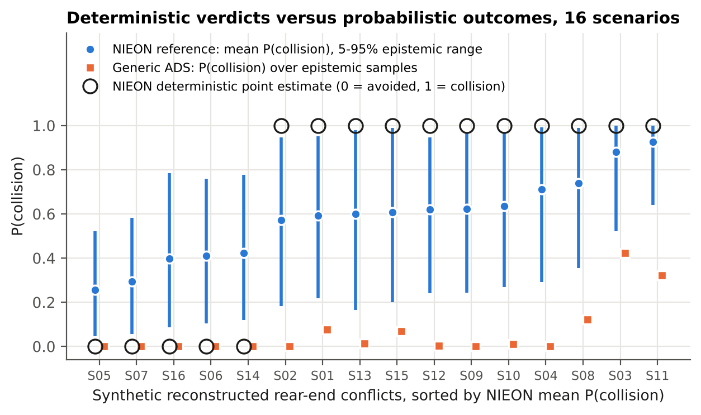
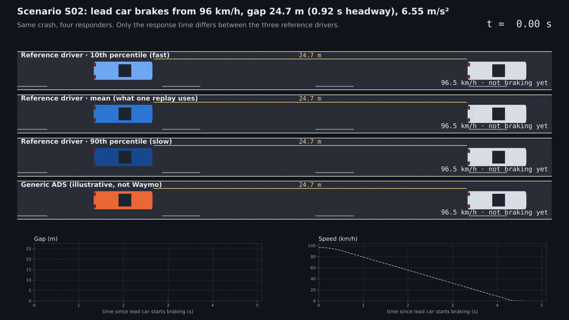

# How certain is a counterfactual crash simulation?

[](https://doi.org/10.5281/zenodo.23838254)

Uncertainty quantification for reference-model benchmarking of automated driving systems (ADS), with an interactive browser simulator, an animated video and a CARLA 3D demonstration.

Waymo evaluates its driver by simulating it, and a human reference model called **NIEON** (Non-Impaired, Eyes ON the conflict), in reconstructed real crashes. Each crash is simulated once, from one deterministic reconstruction and a point-estimate response time, and Waymo's papers have listed uncertainty modeling as future work since 2021. This repository implements that step. It uses Waymo's own published response-time model and injury threshold, with the uncertainty methods of nuclear probabilistic risk assessment (PRA).

- **Technical report** (v1.2, 57 pages, written for non-specialists): [`docs/technical_report.pdf`](docs/technical_report.pdf) ([Word](docs/technical_report.docx)). It covers the literature review, every model and equation with its source, an equation register, an assumption register, the results, the simulators, limitations and future work.
- **Short note** (9 pages): [`docs/technical_note.pdf`](docs/technical_note.pdf)



## Key results (16 synthetic rear-end conflicts)

| Result | Value |
|---|---|
| Collisions avoided by the reference driver, deterministic | 5 of 16 |
| Same, with uncertainty: median (90% interval) | 7 (2–12) |
| Probability that the deterministic count is exactly right | 12% |
| Scenarios whose deterministic verdict flips with probability > 20% | 14 of 16 |
| Avoided at the 10th / 50th / 90th response-time percentile | 14 / 5 / 0 |
| Largest published-parameter driver of uncertainty (total Sobol index) | response-time slope, 0.31 |

## See it: three simulators



| Tool | What it does | Run |
|---|---|---|
| **Browser simulator** [`simulator/rear-end-sim.html`](simulator/rear-end-sim.html) | Animated road view, live gauges and charts. Every input can be set by hand or loaded from S01–S16. Includes a 10,000-replay uncertainty check. | Download the file and open it in any browser (no installation) |
| **2D video** [`results/video_S02.mp4`](results/video_S02.mp4) | Scenario S02 at half speed: three reference drivers and the generic ADS | `python scripts/make_video.py --scenario S02` |
| **CARLA 3D demonstration** [`scripts/carla_demo.py`](scripts/carla_demo.py) | Up to four lanes on a CARLA highway, with drone, chase and dash cameras, front radar, collision sensors and a telemetry overlay; records an MP4 | Windows: double-click [`RUN_CARLA_DEMO.bat`](RUN_CARLA_DEMO.bat). Setup: [`docs/CARLA_SETUP.md`](docs/CARLA_SETUP.md) |

All three use the same equations and parameters as the analysis. The browser simulator reproduces the Python results for S02 (report Table 13; check with `node scripts/check_simulator.js`).

## What is in the model

- **Physics:** lead-vehicle braking, a jerk-limited responder, contact detection (`src/cfuq/simulate.py`)
- **Reference driver:** response time = 0.63 + 0.47 × ramp-up time (Engström et al. 2024), with ramp-up time computed from simulated visual looming (`src/cfuq/models.py`)
- **Generic ADS:** fixed latency plus braking. It is illustrative only and does not represent any real system.
- **Injury:** MAIS3+ logistic curve anchored on the TARGET rear-end threshold (Campolettano et al. 2025)
- **Uncertainty:** two-loop Monte Carlo (an epistemic outer loop with scrambled Sobol QMC and an aleatory inner loop), plus Sobol sensitivity indices with grouped inputs and bootstrap confidence intervals (`src/cfuq/sobol.py`, checked against the analytic Ishigami values)

Every input is labeled published, derived or assumed in `src/cfuq/parameters.py`, with its source and reasoning. The report's Sections 6.6 and 6.7 list the source of every equation and every assumption.

## Reproduce

Requires Python 3.10 or newer.

```bash
pip install -r requirements.txt
python tests/test_core.py                # 7 tests: physics closed form, Sobol on Ishigami, derived statistics
python scripts/run_analysis.py           # about 2 minutes; writes results/ (CSV, JSON, PNG)
python scripts/run_analysis.py --quick   # small samples, about 10 seconds
python scripts/supplementary.py          # workflow, time-history and convergence figures
python scripts/concept_figures.py        # concept figures A–J and the worked example
python scripts/equation_images.py        # equation images used in the slides
python scripts/make_video.py             # results/video_S02.mp4 (needs FFmpeg)
python scripts/simulator_figures.py      # simulator figures for the report
python scripts/carla_demo.py --dry-run   # CARLA demo, model part only (no CARLA needed)
python scripts/build_report.py           # fills docs/report_template.md with numbers from results/
python scripts/build_docs.py             # Word and PDF (needs pandoc; see requirements-docs.txt)
```

Every number in the report is inserted from the result files by `build_report.py`, so the report always matches the code. All sampling uses fixed seeds, so results are reproduced exactly.

## Repository layout

```
src/cfuq/            model, uncertainty and Sobol code
tests/               verification tests
scripts/             analysis, figures, video, CARLA demo, report build
simulator/           interactive browser simulator (single HTML file)
results/             CSV/JSON results, figures, video; simulators/ for Section 15
docs/                technical report (Markdown source, Word, PDF), short note, CARLA setup
RUN_CARLA_DEMO.bat   one-click CARLA demo on Windows
```

## Limitations

- The scenarios are synthetic, and only one conflict type is modeled.
- Several ranges are assumed. They are listed and their influence is quantified, but they are not data.
- The NIEON braking profile and its evasive logic (braking or swerving, whichever is best) are not reproduced.
- The ADS model is generic.
- The simulators illustrate the model; they are not validation.

See report Sections 10 and 15.4.

## Context

This is the first piece of a larger project: an open, integrated PRA-style risk model for driverless fleets, with event trees, fault trees with common-cause failures, and human reliability analysis for remote assistance. Related repository: [av-safety-bayesian-analysis](https://github.com/mohalbati/av-safety-bayesian-analysis).

## Citation

Albati, M. (2026). *How Certain Is a Counterfactual Crash Simulation? Uncertainty quantification for reference-model benchmarking of automated driving systems* (v1.2) [Software and technical report]. Zenodo. https://doi.org/10.5281/zenodo.23838254

See also [`CITATION.cff`](CITATION.cff) and GitHub's "Cite this repository" button.

## Author

Mohammad Albati, Ph.D. · [GitHub](https://github.com/mohalbati)

MIT License.
