# Abstract

Developers of automated driving systems (ADS) estimate how their systems would perform in rare, severe crashes by simulating them in reconstructed real-world crashes. They then compare the result with a human reference driver, a method called counterfactual simulation. Waymo's published work compares the Waymo Driver with a reference model of a non-impaired driver with eyes on the conflict (NIEON). Each crash is simulated once, from a single reconstruction, and the reference driver's response time is a point estimate. The authors listed uncertainty modeling as future work in 2021, and it is still listed in 2026.

This report develops and demonstrates an uncertainty-quantification framework for this kind of benchmarking. It uses the response-time model Waymo published (Engström et al., 2024) and the injury-tolerance threshold Waymo published (Campolettano et al., 2025). Uncertainty is treated as in nuclear probabilistic risk assessment (PRA): a nested (two-loop) Monte Carlo separates epistemic uncertainty (what the reconstruction and model parameters really are) from aleatory variability (differences between individual drivers). Variance-based (Sobol) sensitivity analysis then ranks the sources.

The framework was applied to «N_SCEN» synthetic rear-end conflicts in which a lead vehicle brakes hard. Results:

- **Single-run verdicts are fragile.** In «FLIP_N» of «N_SCEN» conflicts, the deterministic "avoided / not avoided" verdict for the reference driver has more than a 20% probability of being reversed.
- **The count is uncertain.** The deterministic count of avoided collisions («DET_N» of «N_SCEN») has a 90% interval of «CNT_P05» to «CNT_P95».
- **The choice of reference percentile dominates.** The 10th, 50th and 90th percentile reference drivers avoid «REF10», «REF50» and «REF90» collisions respectively.
- **Interactions matter.** The slope of the published response-time regression is the most influential epistemic parameter (total Sobol index «ST_RTK»), and most of the variance comes from interactions that one-at-a-time sensitivity studies would miss.

The report recommends five practices for probabilistic reporting of reference-model benchmarks. Code, data and tests are open source. Three companion tools make the model visible: an interactive browser simulator, an animated video and a 3D demonstration in the CARLA driving simulator (Section 15).

**Keywords:** automated driving systems; counterfactual simulation; reference driver model; NIEON; uncertainty quantification; aleatory and epistemic uncertainty; Sobol sensitivity analysis; probabilistic risk assessment.

# How to read this report

**Who it is for.** The report is written for readers who know some engineering or statistics but are new to automated-vehicle safety, crash simulation or probabilistic risk assessment. Every technical term is defined in Section 2. Each model in Section 5 starts with an "In plain words" paragraph and ends with a "Where it comes from" box, which states what is taken from published data, what is basic physics, and what is an assumption made for this study. Section 6.6 lists the source of every equation, and Section 6.7 lists every assumption with its likely effect.

**Suggested paths through the report.**

- **Ten minutes:** the plain-language summary below, then Section 13 (Conclusions).
- **Thirty minutes:** add Section 3.7 (gaps in the literature), Section 5.9 (a worked example of one crash, step by step) and Sections 8.1 to 8.5 (results).
- **Full technical read:** everything, including the equation and assumption registers and Section 14 (code).
- **To see the model in action:** Section 15, then open the browser simulator (`simulator/rear-end-sim.html`) and try your own numbers.

## Plain-language summary

**The question.** A self-driving car company wants to show that its car would have avoided serious crashes that human drivers were involved in. Serious crashes are too rare to wait for them on the road, so the company takes real crashes, rebuilds them in a computer ("reconstruction"), and replays them with its self-driving system in place of one of the human drivers. Because no human is perfect, the result is compared with a computer model of a *good* human driver: attentive, sober and with eyes on the road. Waymo calls this reference driver NIEON.

{width=100%}

**The problem.** Each crash is replayed once, with one best guess of what happened and one best guess of how fast the good human reacts. The answer is a yes or no: avoided or not. But the rebuilt crash is uncertain (police reports rarely give exact speeds and distances), and good human drivers differ from each other, some reacting in 0.8 s and others in 2 s. A single replay hides all of this.

**What this study does.** It replays each crash thousands of times, each time with slightly different but plausible values of the uncertain quantities, as nuclear-plant safety analysts do. This gives, for each crash, *the probability* that the reference driver avoids it and *how sure* we are of that probability. It then uses a standard statistical technique (Sobol sensitivity analysis) to find which uncertain quantities matter most.

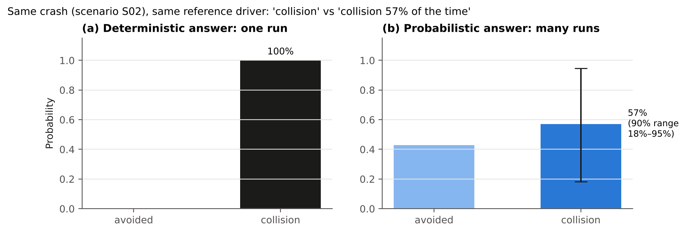{width=92%}

**What it finds** (16 test crashes built for this study):

- **Yes/no answers are fragile.** In «FLIP_N» of the 16 crashes, the yes/no answer has more than a 1-in-5 chance of being the other way.
- **Totals are uncertain.** A total such as "5 of 16 avoided" could reasonably be anywhere from «CNT_P05» to «CNT_P95».
- **The biggest single choice is which "good human" to use.** A quick-reacting human (faster than 90% of good drivers) avoids «REF10» of 16; a typical one avoids «REF50»; a slow-reacting one avoids «REF90». That choice is a policy decision, and it should be stated openly.
- **Better data would help most in two places.** The first is how hard the lead car braked. The second is how much an individual driver's reaction time depends on how the situation unfolds.

**Why it matters.** Safety arguments for self-driving cars increasingly rely on such simulations. Reporting probabilities and ranges, rather than single yes/no answers, makes those arguments more honest and easier to check.

# 1. Introduction

## 1.1 Motivation

Fatal and serious-injury crashes are rare per mile driven. Showing statistically that an automated vehicle reduces them would take hundreds of millions to billions of miles (Kalra & Paddock, 2016), and over 10 billion miles for fatal crashes in the United States (as cited by Scanlon et al., 2021). Developers therefore rely on *prospective* methods that estimate performance before such mileage exists. One of the most persuasive is **counterfactual simulation of reconstructed crashes**:

1. Reconstruct a real crash from police reports and other evidence.
2. Replace one of the human participants with the ADS in a simulator.
3. Ask whether the crash would still have occurred, and how severe it would have been.

Because a perfect driver does not exist, the ADS is judged against a **reference model** of competent human behavior rather than against "no crashes". Waymo's reference is NIEON (Non-Impaired, Eyes ON the conflict). The published results are reported as counts, for example "of 16 conflicts entered, 12 (75%) were prevented by the Waymo Driver, and 10 (62.5%) were prevented by the NIEON model" (Scanlon et al., 2026).

## 1.2 Problem

Each of these counts comes from one deterministic simulation per crash. The authors identify three sources of uncertainty:

- the reconstruction itself, because documentation varied from case to case;
- the reference model, which uses a single response time;
- variability in simulation conditions.

They name probabilistic reconstruction, and alternative reference-model parameters, as future work (Scanlon et al., 2021; 2026). Without these, a reader cannot tell how far a verdict of "avoided" or a count of 10 of 16 would move under reasonable alternative inputs. Nor can a reader tell whether a two-collision difference between the ADS and the reference is meaningful.

## 1.3 Objectives and contributions

This study aims to:

1. Formulate reference-model counterfactual benchmarking as an uncertainty-quantification problem with explicit aleatory and epistemic parts.
2. Build a transparent, open implementation from published models and parameters, with every assumption labeled.
3. Quantify how much single-run verdicts and scenario-set counts change under uncertainty.
4. Identify which uncertainties matter most.
5. Recommend reporting practices.

The contributions are:

- The first (to the author's knowledge) nested Monte Carlo and Sobol treatment of NIEON-style benchmarking.
- Derivation of the response-time regression's parameter uncertainty from published summary statistics.
- A demonstration that the choice of reference-driver percentile changes the benchmark count more than any physical uncertainty does.
- An open, tested Python package.
- Three tools that make the model visible and testable by non-specialists: a browser simulator with its own uncertainty check, an animated video and a CARLA 3D demonstration with cameras and radar (Section 15).

## 1.4 Structure of the report

- A reading guide and plain-language summary precede this section.
- Section 2 defines terms.
- Section 3 reviews Waymo's work and the wider literature and identifies the gaps.
- Section 4 summarizes what this study does differently.
- Section 5 describes each model; Section 6 the uncertainty framework; Section 7 the scenarios.
- Section 8 presents and discusses the results; Section 9 discusses their implications.
- Sections 10 to 13 cover limitations, recommendations, future work and conclusions.
- Section 14 describes the code and how to reproduce every number.
- Section 15 describes the browser simulator, the video and the CARLA demonstration: how each was built, checked and used.

# 2. Terms and definitions

: Table 1. Terms used in this report.

| Term | Meaning in this report |
|---|---|
| ADS | Automated driving system: SAE Level 3 to 5 automation responsible for the whole driving task within its operational design domain (ODD) |
| Conflict | A situation in which two road users approach each other in time and space so that a crash is imminent unless someone takes evasive action |
| Initiator / responder | The road user whose unexpected action creates the conflict / the road user who must react to it. This study models the **responder** role |
| Conflict avoidance vs collision avoidance | Not entering a conflict (for example by keeping a safe gap) vs escaping a conflict already entered (urgent braking or steering). NIEON evaluates collision avoidance only |
| Reconstruction | Estimating pre-crash positions, speeds and accelerations from police reports, photographs, scene measurements and event data recorders |
| Counterfactual simulation | Re-simulating a reconstructed crash with one participant replaced ("what if") |
| Reference (behavior) model | A model of acceptable human performance used as a benchmark. **NIEON** is Waymo's model of a non-impaired driver with eyes on the conflict, a consistently attentive driver that does not exist in the human population |
| Deterministic point estimate | One simulation with every input at a single best-estimate value. In this report, the "mean driver" with nominal reconstruction |
| Stimulus onset (*T*~1~) | The first surprising evidence of the conflict, here the lead vehicle's brake onset (Engström et al., 2024) |
| Visual looming (θ̇) | Rate of expansion of the angle the lead vehicle subtends at the follower's eye (Lee, 1976) |
| Ramp-up time (RUT) | Time from *T*~1~ until looming reaches 0.05 rad/s (*T*~2~); a measure of how quickly evidence of the conflict builds up |
| Response time (RT) | Time from *T*~1~ to the start of the evasive maneuver |
| Jerk | Rate of change of acceleration (m/s³); limits how fast braking builds up |
| Closing speed | Relative speed of the two vehicles at contact |
| Delta-v (Δ*v*) | Change in a vehicle's velocity during the collision; the main predictor in vehicle injury-risk models |
| MAIS3+ | Maximum Abbreviated Injury Scale of 3 or more: serious injury or worse |
| Aleatory uncertainty | Natural variability: differences between individual drivers or trials. It cannot be reduced by learning more about the system, only described |
| Epistemic uncertainty | Lack of knowledge: what the reconstruction or a model parameter really is. It can be reduced with better data |
| Nested (two-loop) Monte Carlo | The outer loop samples epistemic inputs; for each, the inner loop samples aleatory inputs. This yields a *distribution of probabilities* |
| Quasi-Monte Carlo (QMC) | Sampling with low-discrepancy sequences (here scrambled Sobol sequences) that cover the input space more evenly than random sampling |
| Sobol indices | Variance-based sensitivity measures. The first-order index *S*~i~ is the share of output variance explained by input *i* alone; the total index *S*~Ti~ also includes all interactions involving *i* |
| Flip probability | The probability that the outcome differs from the deterministic verdict |

# 3. Literature review

## 3.1 Retrospective and prospective safety assessment of ADS

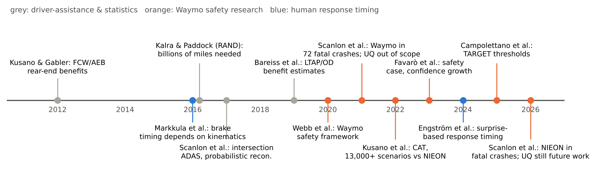{width=100%}


ADS safety evidence falls into two families.

**Retrospective studies** compare observed crash rates with human benchmarks. Examples are Waymo's 7.1-million and 56.7-million-mile studies (Kusano et al., 2024; 2025) and the cross-industry RAVE checklist for such studies (Scanlon et al., 2025). They are strong for frequent, low-severity outcomes, but cannot yet resolve fatal-crash performance: no operator has accumulated enough miles (Scanlon et al., 2026b).

**Prospective studies** estimate performance before such exposure exists, through hazard analysis, scenario-based testing and simulation (Webb et al., 2020). Waymo's safety case combines both families, and treats confidence in its safety determination as something that grows with data (Favarò et al., 2023). Counterfactual crash simulation is the prospective method most directly aimed at severe outcomes.

## 3.2 Counterfactual simulation of reconstructed crashes

Counterfactual simulation has a long history in estimating the benefits of driver-assistance systems:

- Forward collision warning, brake assist and autonomous braking in rear-end crashes (Kusano & Gabler, 2012)
- Intersection driver assistance in straight-crossing-path crashes (Scanlon, Sherony & Gabler, 2017)
- Left-turn-across-path crashes (Bareiss et al., 2019)
- Pedestrian and other systems using in-depth crash data (Hamdane et al., 2015; Gruber et al., 2019, as cited by Scanlon et al., 2021)

Most such studies use a **single representation** of each reconstructed crash. Some vary uncertain conditions probabilistically to explore the range of ways a crash could have happened (Scanlon et al., 2017; Bareiss et al., 2019; Schachner et al., 2020, as cited by Scanlon et al., 2021 and 2026).

**Waymo, 2021 (Scanlon et al., 2021).** The study reconstructed a census of fatal crashes in Chandler, Arizona (2008 to 2017): 72 crashes and 91 vehicle actors, of whom 52 were initiators and 39 responders. It replaced one human driver at a time with the Waymo Driver, with sensor simulation. In the initiator role, the Waymo Driver avoided every collision. In the responder role, 82% of simulations avoided the collision, 10% mitigated it and 8% were unchanged; all the unchanged cases were the Waymo vehicle being struck from behind. The authors note several limitations:

- faults and failures of the ADS are not modeled, and neither is variation in perception;
- modeling uncertainty from the reconstructions and from ADS performance is *out of scope*, and future work will add uncertainty modeling;
- other traffic is largely absent;
- the 2008 to 2017 fleet had little driver assistance.

**Waymo, 2026 (Scanlon et al., 2026a).** The study ran the Waymo Driver and the NIEON model on the potentially avoidable responder conflicts from the 2021 dataset. Of 16 conflicts entered, the Waymo Driver prevented 12 (75%) and NIEON 10 (62.5%). Serious-injury risk fell by 93% and 84% respectively, and in every simulated event the Waymo Driver's serious-injury risk was lower than NIEON's. The stated limitations are:

- only human-initiated scenarios are tested;
- a single reconstruction is used for each crash, despite variable documentation, and probabilistic reconstruction is suggested;
- uninvolved traffic is not modeled;
- a single reference model with a point-estimate response time is used;
- variability in simulation conditions and module-specific failures are not rigorously tested.

Future work includes other reference models and parameter sets "to aid in selecting an acceptable performance level".

## 3.3 Reference behavior models and acceptance criteria

**Waymo's Collision Avoidance Testing (CAT)** (Kusano et al., 2022/2026) applies the NIEON comparison at scale. More than 13,000 scenarios supported the San Francisco and Phoenix launch. The acceptance criterion requires performance comparable to or better than NIEON across scenario groups and road-user groups. NIEON is evaluated with braking, swerving left and swerving right, and the best outcome is chosen. CAT does not consider ADS failure situations such as sensor failures; those are handled by other methods.

**Other reference models.**

- **UN Regulation No. 157** on Automated Lane Keeping Systems contains a human-performance reference model for collision avoidance (UNECE, 2021, as cited by Engström et al., 2024).
- **Responsibility-Sensitive Safety (RSS)** (Shalev-Shwartz et al., 2017) is a rule-based *conflict*-avoidance model. It specifies safe distances so that a vehicle does not enter situations where a collision is unavoidable.

**What they share.** All of these models are deterministic and specify a single "acceptable" human. None of the reviewed documents addresses which percentile of human performance a reference should represent, or how the uncertainty in its parameters affects a benchmark.

## 3.4 Human response-timing models

Classic work treats perception-response time as a fixed property of the driver. For example, Green (2000) suggests about 1.25 s for responses to expected signals such as brake lights.

Naturalistic data show instead that response timing depends strongly on how a situation unfolds. Drivers respond faster when the conflict develops quickly: "a farewell to brake reaction times" (Markkula et al., 2016), with looming as the key visual cue (Lee, 1976).

Engström et al. (2024) formalize this as belief updating driven by *surprise*. In their heuristic implementation, response time is measured from the onset of the surprising stimulus (*T*~1~) and predicted from the ramp-up time to a looming threshold. The fit uses 36 SHRP2 rear-end crashes and near-crashes with non-impaired, eyes-on-path drivers (the NIEON cohort):

- **The fitted relationship** is RT = 0.63 + 0.47·RUT (s), with *p* < 0.001.
- **The correlation in the fitting data** is 0.55.
- **The residuals** are positively skewed, heavy-tailed and heteroscedastic.
- **Against the average response times of four driving-simulator studies**, the model explains 62% of the variance.

The paper also demonstrates a stochastic evidence-accumulation version, fitted by Approximate Bayesian Computation, that produces response-time *distributions*. This is the model behind NIEON's timing.

## 3.5 Injury risk and severity thresholds

**Severity classes.** ISO 26262 classifies severity S0 to S3 by injury probability, and Waymo's early counterfactual results used those classes (Schwall et al., 2020).

**Vehicle injury-risk models.** These predict MAIS3+ risk from delta-v with logistic regression.

**Waymo's TARGET thresholds.** TARGET (Campolettano et al., 2025) derives "safe" impact or closing speeds at 10% MAIS3+ risk for common collision geometries. Examples are 34 km/h for pedestrians, 49 km/h for cyclists and motorcyclists, and closing speeds of 99, 73 and 126 km/h for frontal, near-side and rear-end car-to-car collisions. Delta-v is converted to closing speed by conservation of momentum, with no restitution and equal masses. The thresholds are reported as point values, without uncertainty bands.

## 3.6 Uncertainty treatment in risk assessment

**Nuclear PRA.** Nuclear PRA distinguishes **aleatory** variability from **epistemic** uncertainty (Helton et al., 2004; Der Kiureghian & Ditlevsen, 2009). It propagates both, often with nested sampling, so that results are expressed as a probability with a confidence statement. U.S. NRC guidance (NUREG-1855 Rev. 1, 2017) classifies parameter, model and completeness uncertainty, and requires their treatment in risk-informed decisions.

**Sampling and sensitivity methods.**

- **Sampling designs.** Latin hypercube sampling (McKay et al., 1979) and quasi-Monte Carlo sequences reduce sampling cost.
- **Variance-based sensitivity analysis.** Sobol (2001) indices, with the estimators of Saltelli et al. (2010) and Jansen (1999), quantify each input's contribution, including interactions.

**Within the ADS literature.** Waymo's safety-case work discusses statistical confidence and "continuous confidence growth" (Favarò et al., 2023). Waymo's standardization review asks how simulations should be validated, and how degraded conditions should be analyzed (Schnelle & Favarò, 2023). None of the reviewed Waymo documents applies nested aleatory-epistemic propagation or global sensitivity analysis to its prospective methods.

## 3.7 Summary of gaps

: Table 2. Gaps in the reviewed literature and how this study addresses them.

| # | Gap | Evidence | Addressed here? |
|---|---|---|---|
| G1 | Reconstruction uncertainty not propagated (single deterministic reconstruction) | Scanlon 2021 (out of scope); Scanlon 2026a (future work) | Yes, as epistemic inputs (Section 6) |
| G2 | Reference-model parameters used as point estimates | Scanlon 2026a; Kusano 2022/2026 | Yes; regression parameter uncertainty derived from published statistics (Section 5.3) |
| G3 | Population variability of the reference driver ignored | NIEON uses one response time; Engström 2024 shows wide, skewed scatter | Yes, as aleatory input (Section 5.3) |
| G4 | Reference performance level (percentile) not specified | Scanlon 2026a future work | Yes; 10th, 50th and 90th percentile analysis (Section 8.5) |
| G5 | Benchmark counts reported without intervals | "12 of 16 vs 10 of 16" | Yes; count distributions (Section 8.3) |
| G6 | No ranking of uncertainty sources | Not found in reviewed papers | Yes; Sobol indices (Section 8.4) |
| G7 | Injury thresholds without uncertainty | TARGET point values | Partly; slope treated as epistemic (Section 5.7) |
| G8 | ADS failure states excluded from collision-avoidance testing | Kusano 2022/2026 | No; future work (Section 12) |

# 4. What this study does, and how it differs

{width=100%}

: Table 3. Waymo practice, the wider literature and this study compared.

| Aspect | Waymo practice (2021, 2026) | Wider literature | This study |
|---|---|---|---|
| Crash data | Real reconstructed fatal crashes (Chandler, AZ) | Crash databases (NASS/CISS, GIDAS); some probabilistic reconstruction | 16 synthetic rear-end conflicts standing in for reconstructions (no access to the case data) |
| Reconstruction | One deterministic representation per crash | Mostly deterministic; some probabilistic | Probabilistic: speed, headway, lead deceleration and lead jerk sampled |
| Reference driver | NIEON, single point-estimate response time; brake or swerve, best outcome | Fixed reaction times; kinematics-dependent models | NIEON-type timing from Engström 2024, with parameter uncertainty and driver-to-driver scatter; braking only |
| ADS | Waymo Driver in its full simulator | Production ADAS models | Generic illustrative ADS (latency plus braking); not Waymo |
| Outcome | Prevented / mitigated / unchanged; serious-injury risk | Benefit estimates | P(collision) with intervals; closing speed; P(MAIS3+) |
| Reporting | Counts of conflicts avoided | Percent reduction | Distributions of counts, flip probabilities, percentile sensitivity |
| Sensitivity | Not reported | Rarely; one-at-a-time | Sobol first-order and total indices, grouped, with bootstrap intervals |
| Openness | Methods published; code and data internal | Varies | All code, parameters and results open |

The study does **not** attempt to reproduce Waymo's numbers or evaluate the Waymo Driver. It demonstrates what the deterministic practice conceals, using the same published reference-model ingredients, and supplies a method and code that can be applied to real reconstructions by anyone who has them.

# 5. Models

Each subsection gives the model's purpose, its equations, its parameters, and the basis for each element:

- **[Physics]**: Newtonian kinematics or geometry
- **[Data]**: fitted to empirical data in a cited publication
- **[Derived]**: computed from published numbers
- **[Assumed]**: an engineering judgment, stated explicitly and tested in the sensitivity analysis

**How to read the source labels.** Each model ends with a box headed *Where it comes from*. A fuller list is in the equation register (Section 6.6) and the assumption register (Section 6.7).

## 5.1 Scenario: lead vehicle braking ahead of a follower

*In plain words.* Two cars drive one behind the other at the same speed. Suddenly the front car brakes hard. The rear car's driver does not react straight away; once they do, they brake as hard as they can. The question is whether the rear car stops before reaching the front car.


A lead vehicle (LV) and a following subject vehicle (SV, the responder) travel at the same initial speed *v*~0~ with time headway *h*. The initial bumper-to-bumper gap is therefore *x*~0~ = *h*·*v*~0~. At *t* = 0 the LV begins to brake unexpectedly [Assumed scenario type, the most common rear-end configuration S.1 in Engström et al. 2024].

The LV deceleration ramps up at jerk *j*~L~ until it reaches *a*~L~, and is held until the LV stops [Physics, with *a*~L~ and *j*~L~ as reconstruction inputs]:

$$a_L(t)=\min\left(j_L\,t,\;a_L\right),\qquad t\ge 0 \qquad (1)$$

Both vehicles obey the kinematics below, with speeds never negative [Physics]:

$$\frac{dv_L}{dt}=-a_L(t),\qquad \frac{dv_S}{dt}=-a_S(t),\qquad v_L,v_S\ge 0 \qquad (2)$$

The gap evolves as [Physics]:

$$x(t)=x_0+\int_0^t\big(v_L(\tau)-v_S(\tau)\big)\,d\tau,\qquad x_0=h\,v_0 \qquad (3)$$

Equations (2) and (3) are integrated with a fixed step Δ*t* = 5 ms: speeds by explicit Euler, and positions by the trapezoidal rule.

> **Where it comes from.** The scenario type is the most common rear-end conflict in naturalistic driving data (type S.1, "lead vehicle brakes surprisingly", in Engström et al., 2024). Equations (1) to (3) are basic Newtonian kinematics (constant-jerk ramp to a constant deceleration, no wheel-slip modeling). The *values* of speed, headway and lead braking come from the scenario definitions (Section 7) and are treated as uncertain reconstruction inputs (Section 6).

## 5.2 Visual looming and ramp-up time

*In plain words.* A driver notices danger mainly because the car in front *looks bigger, quickly*. Psychologists call the rate at which an object's image grows "looming". When the front car brakes, the image grows slowly at first and then faster and faster. The time it takes to reach a clearly noticeable rate of growth is the ramp-up time (RUT). A sudden, hard stop at close range gives a short RUT; a gentle slow-down far ahead gives a long one.

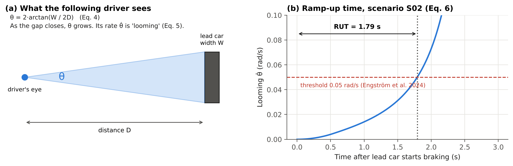{width=100%}


The follower perceives the conflict through the angular size θ of the lead vehicle. The LV has width *W* = 1.8 m [Assumed, a typical passenger car], and *D* is the distance from the driver's eye to the LV's rear [Physics/geometry]:

$$\theta=2\arctan\!\left(\frac{W}{2D}\right),\qquad D=x+d_{eye} \qquad (4)$$

Here *d*~eye~ = 2.0 m is the eye-to-front-bumper distance [Assumed]. Differentiating gives the looming rate [Physics]:

$$\dot\theta=\frac{W\,(v_S-v_L)}{D^2+W^2/4} \qquad (5)$$

Following Engström et al. (2024), the stimulus onset *T*~1~ is the LV brake onset (*t* = 0). *T*~2~ is the first time the looming reaches the threshold θ̇* = 0.05 rad/s [Data: the threshold value is from the paper]:

$$\mathrm{RUT}=T_2-T_1=\inf\{t\ge 0:\dot\theta(t)\ge\dot\theta^*\} \qquad (6)$$

RUT is evaluated with the follower still at constant speed, because in the data the ramp-up precedes the response. Harder lead braking or a shorter gap produces a shorter RUT, which in turn produces a faster response (Eq. 7), consistent with Markkula et al. (2016).

> **Where it comes from.** Equations (4) and (5) are geometry: the angle an object of width *W* subtends at distance *D*, and its time derivative. Looming as the key braking cue is from Lee (1976). The definition of RUT and the threshold of 0.05 rad/s (Eq. 6) are taken directly from Engström et al. (2024, Section 3.4), who chose the threshold to give the best regression fit without losing events. The car width (1.8 m) and the eye-to-bumper distance (2.0 m) are assumptions (A5 in Section 6.7).

## 5.3 Reference-driver response time (NIEON type)

*In plain words.* How fast does a good human driver start braking? Older textbooks give one number, about 1.25 s. Naturalistic driving data show instead that drivers react *faster when the danger develops faster*. Waymo's researchers fitted a straight line: response time equals 0.63 s plus 0.47 times the ramp-up time. This report keeps that line but adds two kinds of uncertainty. First, the line itself was estimated from only 36 events, so its slope and intercept are not exact (epistemic uncertainty). Second, real drivers scatter around the line, some faster and some slower (aleatory variability).

{width=100%}


**Mean model [Data].** The published regression (Engström et al., 2024) gives the expected response time from *T*~1~:

$$\mathrm{RT}=m+k\cdot\mathrm{RUT},\qquad m=0.63\ \mathrm{s},\quad k=0.47 \qquad (7)$$

**Parameter uncertainty [Derived].** The paper reports *n* = 36, a correlation *r* = 0.55 and *p* < 0.001, but not the standard errors. For simple linear regression, the slope's *t*-statistic depends only on *r* and *n*, so the standard error of *k* follows from published numbers alone:

$$SE(k)=k\sqrt{\frac{1-r^2}{r^2\,(n-2)}}=0.47\sqrt{\frac{0.6975}{0.3025\times 34}}=0.122 \qquad (8)$$

This gives *t* = *k*/SE(*k*) = 3.85, which corresponds to a two-sided *p* of about 0.0005. That is consistent with the reported *p* < 0.001, which checks the derivation. The intercept's standard error depends on the unreported mean and spread of RUT. It is taken as SE(*m*) = 0.10 s [Assumed], of the same order as the residual SD divided by √*n*. Both parameters are sampled as normal distributions (*k* truncated at 0).

**Driver-to-driver variability [Derived, with Assumed CV].** With *r* = 0.55 the regression explains *r*² = 30% of the variance, so the residual standard deviation is:

$$\sigma_\varepsilon=\sqrt{1-r^2}\;SD(\mathrm{RT})=0.835\,SD(\mathrm{RT}) \qquad (9)$$

The paper reports positively skewed, heteroscedastic residuals (more scatter at longer RUT). The residual is therefore modeled as *multiplicative lognormal* with unit mean, so that it stays positive, is right-skewed, and has a spread proportional to the mean:

$$\mathrm{RT}_i=(m+k\cdot\mathrm{RUT})\,\varepsilon_i,\qquad \ln\varepsilon_i\sim\mathcal N\!\left(-\tfrac{s^2}{2},\,s^2\right),\qquad s^2=\ln(1+\mathrm{CV}^2) \qquad (10)$$

Here *z*~i~ = (ln ε~i~ + *s*²/2)/*s* is the standard-normal aleatory input. The coefficient of variation is CV ∈ [0.25, 0.55] [Assumed]. For typical mean response times of 0.8 to 1.5 s, this range reproduces the residual SDs implied by Eq. (9) for plausible spreads of RUT (0.5 to 1.5 s), which the paper does not report.

**Two views of the reference driver.**

- **"Mean driver" view.** ε = 1, so the response time equals the regression mean. This is the deterministic practice.
- **"Population" view.** ε is sampled, so the reference represents the NIEON cohort with its natural variation.

A third option, a fixed **percentile driver**, sets *z* to the corresponding standard-normal quantile.

> **Where it comes from.** Equation (7): the published fit of Engström et al. (2024, Eq. 2 and Section 4.1), from 36 SHRP2 rear-end crashes and near-crashes with non-impaired, eyes-on-path drivers. Equation (8): a standard result of simple linear regression (the *t*-statistic of a slope is r√(n−2)/√(1−r²)), applied here to the published *r* and *n*; it is checked against the published *p*-value. Equation (9): a standard regression identity (the explained share of variance is *r*²). Equation (10): an assumption made in this study. The lognormal form is chosen because the paper reports positively skewed, heavy-tailed and heteroscedastic residuals, and a multiplicative lognormal error reproduces those three features while keeping response times positive. The CV range and the intercept standard error are assumptions (A6 and A7).

## 5.4 Responder braking

*In plain words.* Brakes do not reach full force instantly; the force builds up over a fraction of a second (this build-up rate is the "jerk"). The distance needed to stop is the distance covered while reacting, plus the distance covered while the braking builds up, plus the distance covered at full braking.

{width=100%}


After its response time, the responder brakes with deceleration that ramps up at jerk *j* to a maximum *a*~max~ [Physics form; parameter values Assumed]:

$$a_S(t)=\min\!\big(\max\big(j\,(t-\mathrm{RT}),0\big),\;a_{max}\big) \qquad (11)$$

For a stationary obstacle, Eq. (11) gives the closed-form stopping distance used to verify the integrator (test suite) [Physics]:

$$d_{stop}=v_0\,\mathrm{RT}+v_0\tau_j-\frac{j\,\tau_j^3}{6}+\frac{v_1^2}{2a_{max}},\qquad \tau_j=\frac{a_{max}}{j},\quad v_1=v_0-\frac{j\tau_j^2}{2} \qquad (12)$$

For the NIEON-type driver, *a*~max~ is drawn from U[6.5, 8.5] m/s² and *j* from U[10, 30] m/s³ [Assumed]. The NIEON braking profile is not given in the reviewed papers. The ranges represent hard emergency braking by an attentive driver in a modern car with ABS, and the dependence of jerk on kinematic urgency noted by Markkula et al. (2016). Swerving is not modeled.

> **Where it comes from.** The jerk-limited form of Eq. (11) is a standard kinematic idealization of emergency braking. Its use for human drivers follows the observation of Markkula et al. (2016) that braking build-up depends on urgency. Equation (12) is derived here by integrating Eq. (11) and is used only to test the code. The braking ranges are assumptions (A8): the reviewed Waymo papers do not publish the NIEON braking profile.

## 5.5 Generic ADS responder

*In plain words.* A stand-in self-driving system that notices the lead car braking after a short, fixed delay (0.3 to 0.8 s) and then brakes hard. It is deliberately simple. Its only purpose is to show how a comparison with the reference driver behaves when inputs are uncertain.


The ADS reacts a fixed latency τ~ADS~ after the lead vehicle starts to decelerate. The latency includes detection, decision and actuation. It then brakes according to Eq. (11) with its own parameters [Assumed, illustrative]:

$$\mathrm{RT}_{ADS}=\tau_{ADS},\qquad \tau_{ADS}\sim U[0.3,0.8]\ \mathrm{s},\quad a_{max}\sim U[7,9]\ \mathrm{m/s^2},\quad j\sim U[20,40]\ \mathrm{m/s^3} \qquad (13)$$

**This model is not Waymo's system** and makes no claim about any real ADS. It exists to show how a *comparison* between two responders behaves under uncertainty. It has no aleatory component: the same inputs always give the same response.

> **Where it comes from.** Entirely an assumption of this study (A10), chosen to be plausible for a modern automated vehicle. No published Waymo latency or braking value is used, and none is implied.

## 5.6 Contact detection and outcomes

*In plain words.* The simulation checks, every 5 milliseconds, whether the gap between the cars has reached zero. If it has, the crash happened, and the program records how fast the rear car was closing on the front car at that moment.


A collision occurs if the gap reaches zero [Physics]:

$$C=\mathbb 1\Big[\min_{t}x(t)\le 0\Big],\qquad t_c=\inf\{t:x(t)\le 0\} \qquad (14)$$

The contact instant is found by linear interpolation within the time step, and the closing speed is:

$$v_c=v_S(t_c)-v_L(t_c) \qquad (15)$$

The minimum gap is recorded for runs without contact. A run ends at contact, or when the follower has stopped without contact.

> **Where it comes from.** Definitions used in this study. The closing speed at contact is the standard input to the injury model that follows.

## 5.7 Injury risk

*In plain words.* The harder the impact, the more likely a serious injury. In a rear-end crash between two cars of equal mass, the struck car's speed changes by half the closing speed. Waymo's TARGET study found that a rear-end closing speed of 126 km/h gives a 10% chance of serious injury (MAIS3+). This report draws an S-shaped risk curve through that point. How steep the curve is beyond that point is not published, so three plausible steepnesses are tried.

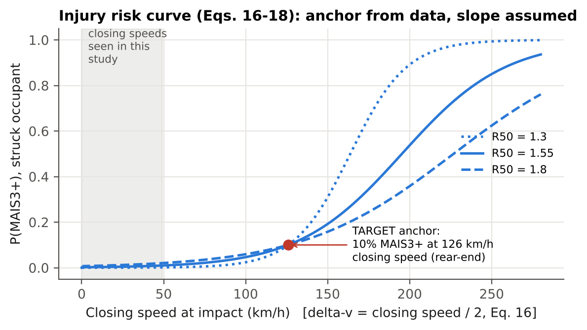{width=82%}


**Delta-v [Physics].** For a collinear rear-end impact between equal masses with no restitution (the same assumptions TARGET uses), conservation of momentum gives the struck vehicle a velocity change of half the closing speed:

$$\Delta v=\frac{m_S}{m_S+m_L}\,v_c=\frac{v_c}{2}\quad(m_S=m_L) \qquad (16)$$

**Risk curve [Form: Data-based convention; anchoring: Data; slope: Assumed].** MAIS3+ risk for the struck occupant is logistic in delta-v (km/h):

$$P(\mathrm{MAIS3+})=\frac{1}{1+\exp\big(-(b_0+b_1\,\Delta v)\big)} \qquad (17)$$

The curve is anchored on TARGET's rear-end threshold. A closing speed of 126 km/h gives 10% risk, so Δ*v*~10~ = 63 km/h. A second point is needed to fix the slope, and it is not recoverable from the published threshold alone. It is therefore set through the ratio *R*~50~ of the 50%-risk delta-v to the 10%-risk delta-v, with *R*~50~ ∈ [1.3, 1.8] [Assumed]:

$$b_1=\frac{\ln 9}{(R_{50}-1)\,\Delta v_{10}},\qquad b_0=-b_1\,R_{50}\,\Delta v_{10} \qquad (18)$$

By construction, the curve passes through 10% at 126 km/h closing speed for every slope; the test suite verifies this.

> **Where it comes from.** Equation (16): conservation of momentum for a perfectly plastic (no-rebound) collinear impact of equal masses, the same assumptions TARGET uses to convert delta-v to closing speed (Campolettano et al., 2025, Section 2). Equation (17): the logistic form is the standard form of the injury-risk functions TARGET builds on. Its anchor point (10% at 126 km/h) is from TARGET. Equation (18) is derived here, and the steepness range R50 is an assumption (A11).

## 5.8 Numerical implementation and verification

All models are vectorized in NumPy, with one array element per sample, so roughly 40,000 complete conflict simulations run per second on a single CPU core. The full analysis takes about 90 s. Seven automated tests check the implementation:

1. The integrator against the closed-form stopping distance, Eq. (12), within ±0.5 m.
2. That identical braking with instant response never collides.
3. That RUT shortens with harder lead braking.
4. The unit mean of the lognormal residual.
5. The injury-curve anchoring, Eq. (18).
6. The derived SE(*k*) and its consistency with the reported *p*-value.
7. The Sobol estimator against the analytic Ishigami function (Ishigami & Homma, 1990).

## 5.9 Worked example: one crash, step by step

To make the models concrete, the deterministic calculation for scenario S02 is shown below. All numbers are produced by the code.

: Table 4a. Worked example, scenario S02, deterministic ("mean driver") calculation.

| Step | Quantity | Equation | Value | What it means |
|---|---|---|---|---|
| 1 | Speed, headway | input | «W_V0» km/h, «W_H» s | both cars at highway speed, a little under one second apart |
| 2 | Initial gap *x*~0~ = *h*·*v*~0~ | (3) | «W_X0» m | about five car lengths |
| 3 | Lead car braking | (1) | ramps at «W_JL» m/s³ to «W_AL» m/s² | a hard but not maximum stop |
| 4 | Ramp-up time | (4)–(6) | «W_RUT» s | looming becomes clearly noticeable after this time |
| 5 | Mean response time RT = 0.63 + 0.47 × «W_RUT» | (7) | «W_RT» s | the average good driver starts braking at this time |
| 6 | Distance covered before braking starts | *v*~0~·RT | «W_REACTD» m | more than the initial gap, but the lead car is slowing too |
| 7 | Gap when braking starts | (3) | «W_GAPRT» m | the gap has shrunk by «W_SHRINK» m |
| 8 | Outcome | (14)–(15) | contact at «W_TC» s, closing speed «W_VC» km/h | the reference driver does not stop in time |
| 9 | Delta-v of struck car | (16) | «W_DV» km/h | half the closing speed |
| 10 | Serious-injury risk | (17)–(18) | «W_PINJ» | low: a moderate-speed rear-end crash |
| 11 | Spread among good drivers (CV = 0.4) | (10) | 10th pct «W_RT10» s; 90th pct «W_RT90» s | a fast driver avoids this crash; a slow one hits harder |
| 12 | Probabilistic answer | (19)–(20) | P(collision) = «S02_MEAN» (90% range «S02_P05»–«S02_P95») | the deterministic "collision" is really a 57% event |

Step 11 is the essence of the problem. The deterministic calculation uses the average response time («W_RT» s). A driver at the 10th percentile («W_RT10» s) starts braking more than half a second earlier, and stops about 11 m short of the lead car. A driver at the 90th percentile («W_RT90» s) hits at about 49 km/h, nearly twice the mean driver's closing speed. The single replay reports only the middle case.

# 6. Uncertainty framework

## 6.1 Classification of inputs

*In plain words.* Risk analysts separate two kinds of "not knowing". **Aleatory variability** is genuine randomness between individuals or trials, such as two good drivers reacting differently to the same event. More data describes it better, but never removes it. **Epistemic uncertainty** is lack of knowledge about a fixed but unknown quantity, such as the true speed in a reconstructed crash, or the true slope of the response-time line. Better data reduces it. Mixing the two hides what better data could achieve, so nuclear PRA keeps them apart (Helton et al., 2004; NUREG-1855).

{width=100%}


: Table 4. All uncertain inputs, with their nominal values, distributions, uncertainty type and basis. Reconstruction ranges are half-widths around each scenario's nominal value.

| Symbol | Input | Nominal | Distribution | Type | Basis |
|---|---|---|---|---|---|
| *v*~0~ | Initial speed | scenario value | ±10% uniform | Epistemic | Assumed (reconstruction quality) |
| *h* | Initial time headway | scenario value | ±25% uniform | Epistemic | Assumed |
| *a*~L~ | Lead deceleration | scenario value | ±20% uniform | Epistemic | Assumed |
| *j*~L~ | Lead brake jerk | 12.5 m/s³ | U[5, 20] | Epistemic | Assumed |
| *m* | RT intercept | 0.63 s | N(0.63, 0.10²) | Epistemic | Data (mean); Assumed (SE) |
| *k* | RT slope | 0.47 | N(0.47, 0.122²), ≥0 | Epistemic | Data (mean); Derived (SE, Eq. 8) |
| CV | Residual coefficient of variation | 0.40 | U[0.25, 0.55] | Epistemic | Derived/Assumed (Eq. 9) |
| *a*~max~ | NIEON maximum deceleration | 7.5 m/s² | U[6.5, 8.5] | Epistemic | Assumed |
| *j* | NIEON brake jerk | 20 m/s³ | U[10, 30] | Epistemic | Assumed |
| τ~ADS~ | ADS latency | 0.55 s | U[0.3, 0.8] | Epistemic | Assumed (illustrative) |
| *a*~max,ADS~ | ADS maximum deceleration | 8 m/s² | U[7, 9] | Epistemic | Assumed (illustrative) |
| *j*~ADS~ | ADS brake jerk | 30 m/s³ | U[20, 40] | Epistemic | Assumed (illustrative) |
| *R*~50~ | Injury-curve slope ratio | 1.55 | U[1.3, 1.8] | Epistemic | Assumed |
| *z* | Driver response-time residual | 0 (mean) | N(0, 1) through Eq. (10) | **Aleatory** | Data-based (scatter reported) |
| θ̇*, *W*, *d*~eye~ | Looming threshold, width, eye offset | 0.05 rad/s, 1.8 m, 2.0 m | fixed | n/a | Data; Assumed; Assumed |
| Δ*v*~10~ | 10%-risk delta-v | 63 km/h | fixed | n/a | Data (TARGET) + Physics (Eq. 16) |

## 6.2 Nested Monte Carlo

*In plain words.* The calculation runs in two nested loops. The outer loop picks one plausible version of everything we are unsure about: the crash details and the model parameters. The inner loop then replays the crash with 200 different good drivers drawn from the population, and counts how many crash. That count, divided by 200, is the collision probability *for that version of our knowledge*. Repeating the outer loop 512 times gives 512 probabilities. Their spread shows how sure we are.

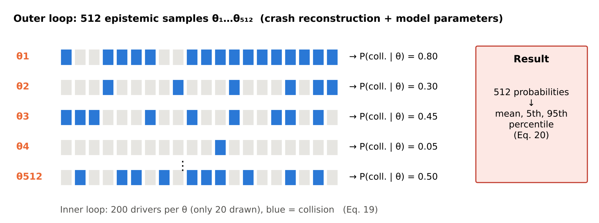{width=100%}


Let θ be the vector of 13 epistemic inputs and *z* the aleatory residual. For each scenario and each epistemic sample θ~i~, the **conditional collision probability** is the expectation over the driver population:

$$P_c(\theta_i)=\mathbb E_z\big[C(\theta_i,z)\big]\approx\frac{1}{N_I}\sum_{l=1}^{N_I}C(\theta_i,z_l) \qquad (19)$$

with *N*~I~ = 200 inner draws. The outer loop uses *N*~O~ = 512 scrambled Sobol points mapped to the distributions in Table 4, and gives the epistemic distribution of *P*~c~. This is summarized by its mean and percentiles:

$$\bar P_c=\frac{1}{N_O}\sum_{i=1}^{N_O}P_c(\theta_i),\qquad P_c^{(q)}=\text{empirical }q\text{-quantile of }\{P_c(\theta_i)\} \qquad (20)$$

The **flip probability** is the probability that the outcome differs from the deterministic verdict *C*~det~:

$$p_{flip}=\begin{cases}\mathbb E_\theta\big[1-P_c(\theta)\big] & \text{if } C_{det}=1\\ \mathbb E_\theta\big[P_c(\theta)\big] & \text{if } C_{det}=0\end{cases} \qquad (21)$$

For the ADS, which has no aleatory part, *P*~c~(θ) is 0 or 1, and its mean over θ is the probability of collision.

## 6.3 Scenario-set counts

Benchmark reports count conflicts avoided. For one realization ω of the uncertainties:

$$N_{av}(\omega)=\sum_{s=1}^{16}\big(1-C_s(\omega)\big) \qquad (22)$$

Within a realization, the model parameters (*m*, *k*, CV, braking, ADS and injury parameters) are **shared** across scenarios, because they represent one state of knowledge about the reference and the ADS. The reconstruction errors and the driver residual are **independent** for each scenario. Four thousand realizations give the distribution of *N*~av~ for each responder, and the probability that the ADS avoids more collisions than the reference:

$$P_{ADS>ref}=\Pr\big[N_{av}^{ADS}>N_{av}^{ref}\big] \qquad (23)$$

## 6.4 Source decomposition and reference-percentile analysis

To separate the sources, the mean-driver count is recomputed with:

1. reconstruction uncertainty only (model parameters at nominal);
2. the same, with the reconstruction ranges halved;
3. model uncertainty only (reconstruction at nominal);
4. both.

Separately, the deterministic count is recomputed with the reference driver fixed at the 10th, 50th and 90th percentiles of the response-time distribution. In that case *z* equals the standard-normal quantile, and every other input is nominal.

## 6.5 Variance-based sensitivity analysis

*In plain words.* Sensitivity analysis asks which uncertain inputs are responsible for the spread in the answer. The simple approach changes one input at a time while holding the others fixed, which misses combined effects. For example, a slow reaction matters only if the lead car also brakes hard and the gap is short. Sobol indices split the total spread into a part due to each input *alone* (first-order index) and a part due to its *combinations* with other inputs (the total index includes both).

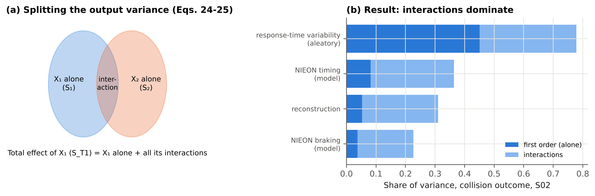{width=100%}


For an output *Y* (collision indicator, or closing speed with 0 when avoided) and inputs *X*~1~, …, *X*~d~ treated as independent, the first-order and total Sobol indices are (Sobol, 2001):

$$S_i=\frac{\mathrm{Var}_{X_i}\big(\mathbb E[Y\mid X_i]\big)}{\mathrm{Var}(Y)} \qquad (24)$$

$$S_{Ti}=\frac{\mathbb E_{X_{\sim i}}\big[\mathrm{Var}(Y\mid X_{\sim i})\big]}{\mathrm{Var}(Y)} \qquad (25)$$

**Interpretation.** *S*~i~ is the share of variance that would be removed if *X*~i~ were known exactly. *S*~Ti~ is the share that would remain if every input *except* *X*~i~ were known. The difference *S*~Ti~ − *S*~i~ measures interactions.

**Estimators.** Two independent base matrices **A** and **B** (*N* = 8,192 rows each, from a scrambled Sobol sequence) are used, together with **A**~B~^(i)^: matrix **A** with column *i* taken from **B**. Indices are estimated with the Saltelli et al. (2010) estimator for *S*~i~ and the Jansen (1999) estimator for *S*~Ti~:

$$\hat S_i=\frac{\frac1N\sum_r f(\mathbf B)_r\big[f(\mathbf A_B^{(i)})_r-f(\mathbf A)_r\big]}{\widehat{\mathrm{Var}}(Y)} \qquad (26)$$

$$\hat S_{Ti}=\frac{\frac{1}{2N}\sum_r\big[f(\mathbf A)_r-f(\mathbf A_B^{(i)})_r\big]^2}{\widehat{\mathrm{Var}}(Y)} \qquad (27)$$

**Groups of inputs** (reconstruction, response-time model, braking model, driver residual) are handled by swapping all of a group's columns at once. This gives closed group indices. Confidence intervals (95%) come from 200 bootstrap resamples of the rows. Sobol analysis is run on the most uncertain scenario: the one whose mean collision probability is closest to 0.5. The aleatory residual is included as an input so that its share can be compared with the epistemic sources.

## 6.6 Equation register: where each equation comes from

: Table 4b. Source of every numbered equation. Type: **Physics** = basic mechanics or geometry; **Data** = fitted to empirical data in a cited study; **Derived** = derived in this report from published numbers or standard results; **Assumed** = a modeling choice of this study; **Method** = standard statistical method.

| Eq. | What it computes | Type | Source |
|---|---|---|---|
| (1) | Lead-car deceleration build-up | Physics (form); inputs uncertain | Constant-jerk idealization; scenario type S.1 from Engström et al. (2024) |
| (2) | Change of speed under braking | Physics | Newton's second law (kinematics) |
| (3) | Gap between the cars over time | Physics | Integration of relative speed |
| (4) | Visual angle of the lead car | Physics (geometry) | Lee (1976); camera-angle form in Engström et al. (2024, Eq. 1) |
| (5) | Looming rate | Physics | Time derivative of Eq. (4); Lee (1976) |
| (6) | Ramp-up time | Data (definition and 0.05 rad/s threshold) | Engström et al. (2024, Section 3.4) |
| (7) | Mean response time | Data | Engström et al. (2024, Eq. 2): *m* = 0.63 s, *k* = 0.47, *n* = 36, *r* = 0.55 |
| (8) | Standard error of the slope | Derived | Standard regression theory applied to the published *n* and *r* |
| (9) | Residual standard deviation | Derived | Regression identity (explained variance = *r*²) |
| (10) | Driver-to-driver scatter | Assumed (form) | Lognormal chosen to match the skew and heteroscedasticity reported by Engström et al. (2024) |
| (11) | Responder braking build-up | Physics (form); Assumed (values) | Constant-jerk idealization; urgency-dependent jerk noted by Markkula et al. (2016) |
| (12) | Closed-form stopping distance | Derived | Integration of Eq. (11); used for code verification only |
| (13) | Generic ADS response | Assumed | Illustrative; not based on any published ADS value |
| (14) | Collision indicator, contact time | Definition | This study |
| (15) | Closing speed at contact | Definition | This study |
| (16) | Delta-v of the struck car | Physics | Momentum conservation, plastic impact, equal masses; same assumptions as TARGET (Campolettano et al., 2025) |
| (17) | Serious-injury probability | Data (form) | Logistic injury-risk functions, as used by TARGET |
| (18) | Injury-curve coefficients | Derived (anchor) + Assumed (slope) | Anchor: TARGET rear-end threshold, 10% at 126 km/h; slope ratio R50 assumed |
| (19) | Conditional collision probability | Method | Nested (two-loop) Monte Carlo: Helton et al. (2004); NUREG-1855 (2017) |
| (20) | Mean and percentiles over θ | Method | Standard empirical summaries |
| (21) | Flip probability | Definition | This study |
| (22) | Number of conflicts avoided | Definition | Mirrors the counts reported by Scanlon et al. (2026a) |
| (23) | Probability the ADS beats the reference | Definition | This study |
| (24) | First-order Sobol index | Method | Sobol (2001) |
| (25) | Total Sobol index | Method | Homma & Saltelli (1996); Saltelli et al. (2010) |
| (26) | First-order estimator | Method | Saltelli et al. (2010) |
| (27) | Total-effect estimator | Method | Jansen (1999); Saltelli et al. (2010) |

## 6.7 Assumption register

: Table 4c. Every assumption of this study, why it is reasonable, how it could bias the results, and how its influence was checked.

| ID | Assumption | Why it is reasonable | If it is wrong, the likely effect | How it was checked |
|---|---|---|---|---|
| A1 | Synthetic scenarios replace real reconstructions | The case data are not public; the parameter ranges span real rear-end conflicts | The numbers are illustrative; the qualitative findings should transfer | Findings stated qualitatively; method ready for real data |
| A2 | Only lead-vehicle-braking conflicts | The best-characterized timing model exists for this type | Other types probably show *larger* uncertainty | Stated as a limitation |
| A3 | Reconstruction errors ±10% speed, ±25% headway, ±20% lead deceleration, uniform | Typical precision of police-report-based reconstructions; no published values | Too wide inflates the spread | Halving the ranges barely changes the count interval (Table 9) |
| A4 | Lead brake jerk 5–20 m/s³ | Covers moderate to very abrupt brake onsets | Changes RUT and the gap at response | In the Sobol analysis (*S*~T~ about 0.11) |
| A5 | Lead car width 1.8 m; eye 2.0 m behind the bumper | Typical passenger-car geometry | Small shifts in RUT | Fixed; a small effect, since looming scales with *W* |
| A6 | Intercept standard error 0.10 s | Not reported; same order as residual SD/√*n* | Changes the spread of RT | In the Sobol analysis (*S*~T~ about 0.14) |
| A7 | Lognormal scatter, CV 0.25–0.55 | Matches the reported skew and heteroscedasticity, and the implied residual SD | Heavier tails would lower the high-percentile counts | CV is an uncertain input (*S*~T~ about 0.10) |
| A8 | NIEON braking: 6.5–8.5 m/s², jerk 10–30 m/s³; braking only, no swerve | Hard braking by attentive drivers with ABS; the profile is not published | Real NIEON also swerves, so avoidance is probably *underestimated* | Braking is an uncertain input (group *S*~T~ about 0.23) |
| A9 | Linear RT–RUT line extrapolated beyond the fitted RUT range | The paper's model has no stated bounds | Affects gentle (long-RUT) conflicts | Stated as a limitation |
| A10 | Generic ADS: latency 0.3–0.8 s, braking 7–9 m/s², jerk 20–40 m/s³ | Plausible for an automated system; illustrative only | No claim about any real ADS | Not interpreted as a finding about Waymo |
| A11 | Injury curve steepness R50 1.3–1.8 | Typical shapes of logistic risk curves | Negligible here (closing speeds are low) | An uncertain input |
| A12 | All inputs independent | No published correlations | Correlated reconstruction errors could widen or narrow the spread | Stated as a limitation |
| A13 | No other traffic, occlusions or signals | Matches the simple rear-end case | Could change avoidance options | Stated as a limitation |
| A14 | Model parameters shared across scenarios within one realization | One state of knowledge about the reference driver applies to all crashes | Treating them as independent would narrow the count interval | Both views reported (Table 7) |

# 7. Scenarios

## 7.1 Why synthetic scenarios

The case data behind Waymo's reconstructions are not public. Sixteen synthetic conflicts, the same number as in Scanlon et al. (2026a), were therefore generated as stand-ins for reconstructed rear-end crashes. They were drawn by Latin hypercube sampling (seed 2026) from:

- initial speed 11 to 31 m/s (40 to 112 km/h), covering urban arterials to freeways;
- time headway 0.3 to 1.6 s;
- lead-vehicle deceleration 5.5 to 9.5 m/s², from hard braking to a near-maximum emergency stop.

The ranges were chosen so that the set contains both conflicts a reference driver avoids and conflicts it does not, as in a real crash sample in which the original drivers all crashed. The scenarios are not real crashes. The method, not the specific numbers, is what transfers to real reconstructions.

## 7.2 The sixteen conflicts and their deterministic outcomes

: Table 5. Scenario definitions and deterministic ("mean driver", nominal reconstruction) outcomes. RUT and RT are from Eqs. (6) and (7); closing speed is at contact (0 if avoided).

«SCEN_TABLE»

**Patterns in the deterministic results.**

- **Headway decides avoidance.** The deterministic reference driver avoids «DET_N» of «N_SCEN» conflicts, and all of them have headways of 1.07 s or more. Every conflict with a headway of 1.0 s or less results in a collision. Between 1.07 and 1.20 s the outcome depends on speed and lead braking: S16 (87 km/h, 5.7 m/s²) is avoided, while S09 (91 km/h, 7.7 m/s²) and S04 (110 km/h, 8.0 m/s²) are not. Closing speeds at contact range from 12 to 49 km/h. Headway matters so much because the reference driver's response time (0.87 to 1.69 s) is comparable to or longer than the headway. The longer RUT at longer headway (Eq. 6) partly offsets the advantage of the larger gap. This is the kinematics-dependent timing effect of Markkula et al. (2016) and Engström et al. (2024).
- **The ADS's small margin.** The generic ADS reacts in 0.55 s and avoids all 16 conflicts at nominal values, but with small margins in the shortest-headway or hardest-braking cases. Its minimum gap is 0.2 m in S03, 2.9 m in S11, 3.3 m in S01, 4.0 m in S08 and 5.1 m in S15. That makes those cases sensitive to its own parameters (Section 8.2).
- **Low injury risk.** Nominal closing speeds stay below 50 km/h, far below TARGET's 126 km/h rear-end threshold, so the MAIS3+ risk in these scenarios is low (Section 8.6).

{width=100%}

**How one conflict unfolds (Figure 2).** In S02 the lead vehicle brakes from 96 km/h. Looming reaches the threshold «S02_RUT» s after brake onset, and the deterministic reference driver starts braking at «S02_RT» s. By then the gap has shrunk from «S02_X0» m to «S02_GAPRT» m, and the driver hits the lead vehicle at «S02_VC» km/h after «S02_TC» s. The ADS, braking from 0.55 s, never comes closer than «S02_ADSGAP» m. The 40 sampled realizations (blue) show the same conflict under plausible alternative reconstructions, response times and braking: some end in contact between 3 and 4.4 s, and others stop with gaps of up to 24 m. A single deterministic run shows only one of these possible outcomes.

# 8. Results and discussion

## 8.1 A single deterministic verdict hides a wide distribution

*In plain words.* For one crash, the single replay said "collision". Replaying it with all the plausible variations gives a collision probability anywhere from about 0.2 to almost 1, depending on what we assume about the crash and the driver model. On average it is 0.57: close to a coin toss.


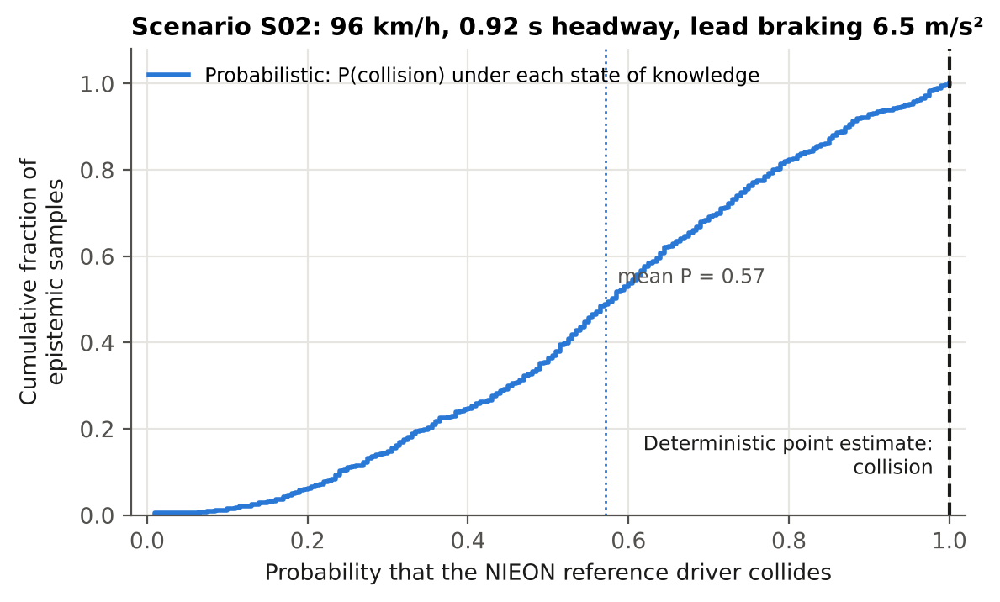{width=86%}

Each point on the curve in Figure 3 is one state of knowledge θ~i~, with its probability that a NIEON-cohort driver collides. For S02 the distribution spans about 0.2 to almost 1 (5th to 95th percentile «S02_P05» to «S02_P95»), with a mean of «S02_MEAN». The deterministic verdict "collision" is the right-hand end of this range.

The deterministic answer is not "wrong". It is a binary summary of a quantity that is genuinely continuous. A decision maker given only the verdict cannot distinguish a conflict that the reference fails 95% of the time from one it fails 55% of the time. Yet for a safety argument the difference matters: it changes how much credit the ADS should get for avoiding that conflict.

## 8.2 Across the sixteen scenarios

*In plain words.* The same pattern holds for all 16 crashes. Crashes the single replay calls "collision" are really collisions 57% to 92% of the time. Crashes it calls "avoided" are still collisions 25% to 42% of the time.


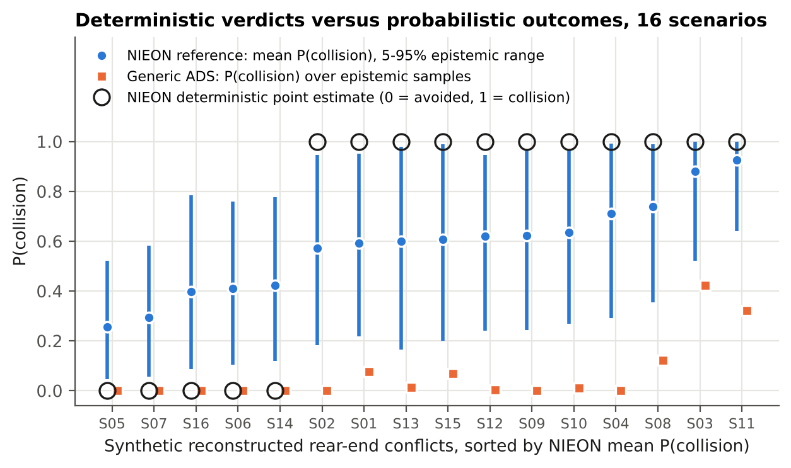{width=96%}

: Table 6. Probabilistic results by scenario. Population view unless marked "mean driver".

«PROB_TABLE»

**Observations from Figure 4 and Table 6.**

1. **The verdict maps onto a band of probabilities, not 0 or 1.** Every deterministic "collision" corresponds to a mean collision probability between «COLL_MIN» and «COLL_MAX». Every deterministic "avoided" corresponds to a probability between «AV_MIN» and «AV_MAX». The two groups do not overlap, so the deterministic verdict *ranks* scenarios correctly, but it overstates certainty in every case.
2. **Flips are likely.** In «FLIP_N» of «N_SCEN» scenarios the flip probability (Eq. 21) is above 0.2, and it reaches «FLIP_MAX». Only the most severe conflicts (S03 and S11: short headway with hard braking, or high speed) are robust collisions. Even in the narrower mean-driver view (epistemic only), «FLIP_MD_N» scenarios exceed 0.2.
3. **The epistemic ranges are wide.** A typical 90% interval runs from about 0.2 to about 0.95. This means the state of knowledge (reconstruction and model parameters) matters as much as driver variability. Section 8.4 shows which inputs drive it.
4. **The ADS is robust in most cases, but not everywhere.** The ADS's collision probability is 0.01 or less in «ADS_LOW_N» scenarios. It rises to «ADS_MAX» in the shortest-headway, hardest-braking conflicts (S03, S11, S08), where the ADS avoids the collision at nominal values but not under some plausible reconstructions. Those scenarios would be the most informative to reconstruct more carefully.

## 8.3 Benchmark counts are distributions

*In plain words.* When the 16 answers are added up into a score ("5 of 16 avoided"), that score is itself uncertain: it could plausibly be anywhere from 2 to 12. Comparing two such scores (for example 12 versus 10) therefore needs a probability statement, not just the two numbers.


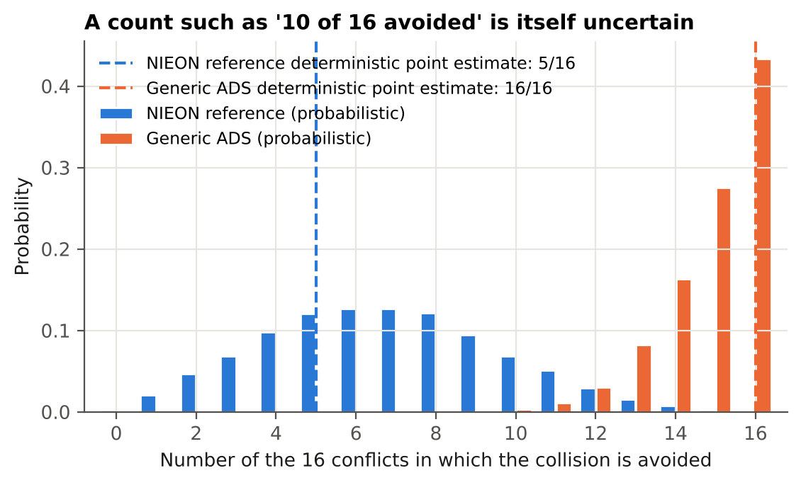{width=88%}

: Table 7. Number of conflicts avoided (of 16): deterministic and probabilistic.

| Responder | Deterministic | Median | Mean | 90% interval | P(count = deterministic) |
|---|---|---|---|---|---|
| Reference, population view | «DET_N» | «CNT_P50» | «CNT_MEAN» | «CNT_P05»–«CNT_P95» | «P_EQ» |
| Reference, mean-driver view | «DET_N» | «MD_P50» | «MD_MEAN» | «MD_P05»–«MD_P95» | «P_EQ_MD» |
| Generic ADS | «DET_ADS» | «ADS_P50» | «ADS_MEAN» | «ADS_P05»–«ADS_P95» | — |

**What Table 7 shows.**

- **The count is far from certain.** The deterministic count of «DET_N» has a probability of only «P_EQ» of being exactly right under uncertainty.
- **The deterministic count is low.** The median of the probabilistic count («CNT_P50») is above the deterministic value. Two effects combine. First, «DET_COLL» of the 16 deterministic verdicts are collisions, each with a 25–43% chance of flipping to avoidance (Table 6), while only «DET_N» avoidances can flip the other way. Second, with a right-skewed residual, the typical (median) driver responds faster than the mean driver. In the mean-driver view, which has no residual, the median count («MD_P50») stays close to the deterministic value.
- **The two views differ in shape.** In the mean-driver view the count is more spread out (90% interval «MD_P05»–«MD_P95»), because model-parameter uncertainty moves all 16 scenarios together. The population view adds independent variation between scenarios, which partly averages out.
- **The ranking here is robust.** The generic ADS avoids more collisions than the reference in «P_ADS_GT» of realizations («P_ADS_GT_MD» in the mean-driver view). This is because its performance advantage was made large by design.

**Implication for close comparisons.** With a difference of two conflicts, as in the published 12 versus 10, the interval widths in Table 7 show that the ranking would need a probabilistic statement (Eq. 23) to be defended. The counts alone cannot support it.

## 8.4 Which uncertainties matter: Sobol sensitivity

*In plain words.* The largest share of the spread comes from natural differences between good drivers. Among the things better data could fix, the most important are the slope of the published response-time line and how hard the lead car braked. Almost all of the effects act in combination rather than alone.


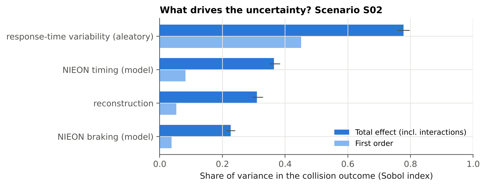{width=84%}

: Table 8. Sobol indices for scenario «SOBOL_S» (bootstrap 95% intervals in brackets).

«SOBOL_TABLE»

**Reading the indices.**

1. **Driver-to-driver variability is the largest single source** (*S*~T~ = «ST_RES» for collision; «ST_RES_V» for closing speed). This is aleatory: it cannot be reduced by better data, only described. It is a property of the reference population. A benchmark that represents the reference by its mean drops this part of the variance and replaces it with a policy choice (Section 8.5).
2. **Among epistemic inputs, the response-time slope *k* matters most** (*S*~T~ = «ST_RTK»). Its uncertainty is not an assumption of this study: it follows from the published fit, *n* = 36 and *r* = 0.55 (Eq. 8). A larger fitting sample would reduce it directly.
3. **Lead-vehicle deceleration is the most influential reconstruction input** (*S*~T~ = «ST_AL»). This suggests that reconstruction effort is best spent on the lead vehicle's braking (for example from event data recorder or video evidence), rather than on refining initial speed (*S*~T~ = «ST_V0»).
4. **Interactions dominate the collision outcome.** Total indices are much larger than first-order ones: the first-order indices sum to «SUM_S1», but the total indices sum to well above 1. A collision is a threshold event, so an input matters only in combination with others. For example, a slow response is harmful only when the lead vehicle brakes hard and the gap is short. One-at-a-time sensitivity studies vary one input with the others fixed at nominal values, and so miss most of this variance.
5. **For the continuous closing speed, the structure is more additive** (first-order indices sum to «SUM_S1_V»). The ordering is the same.

## 8.5 Where the count's uncertainty comes from, and the reference-percentile choice

*In plain words.* Uncertainty in the crash reconstruction alone moves the score by about ±2. Uncertainty in the driver model moves it more. But the biggest change comes from a decision rather than an uncertainty: whether the benchmark "good driver" is a quick, typical or slow member of the good-driver population.


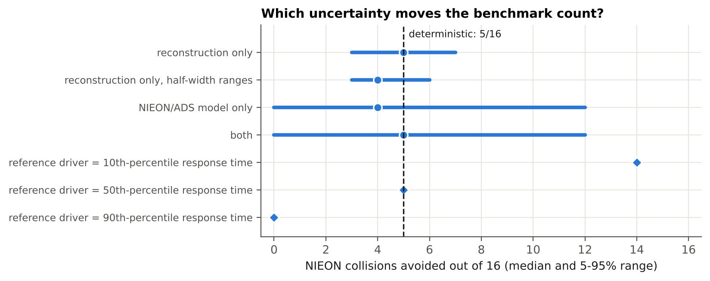{width=88%}

: Table 9. Count of conflicts avoided by the reference driver under different uncertainty sources (mean-driver view) and reference percentiles.

«SRC_TABLE»

**Findings from Table 9.**

- **Reconstruction uncertainty alone** moves the count by roughly ±2 around the deterministic value (90% interval «REC_P05»–«REC_P95»). Halving the assumed reconstruction ranges narrows this only to «REC_H_P05»–«REC_H_P95», so the conclusion does not depend strongly on the exact ranges chosen.
- **Model uncertainty** (reference timing and braking) produces most of the spread («MOD_P05»–«MOD_P95»), because it acts on all scenarios at once.
- **The choice of reference percentile has the largest effect.** A 10th-percentile reference driver (faster than 90% of the cohort) avoids «REF10» of 16. The median driver avoids «REF50», and a 90th-percentile driver avoids «REF90». This choice is not an uncertainty but a **policy decision** about what level of human performance an ADS must match or exceed. It moves the benchmark by more than any physical or statistical uncertainty in this study. Scanlon et al. (2026a) raise exactly this question ("to aid in selecting an acceptable performance level"). The results show that it should be made explicitly, and reported with the benchmark.

## 8.6 Injury severity

The mean MAIS3+ probability for the struck occupant is at most «INJ_MAX» per scenario (95th percentile «INJ_P95»). Rear-end closing speeds in these scenarios (at most «VC_MAX» km/h nominally) are far below TARGET's 126 km/h threshold. In this example, therefore, the collision outcome rather than injury severity dominates the risk. The injury layer is included because it becomes decisive for crossing-path and vulnerable-road-user conflicts, where TARGET's thresholds are much lower (34 km/h for pedestrians), and where the slope uncertainty in Eq. (18) would matter more.

## 8.7 Numerical convergence

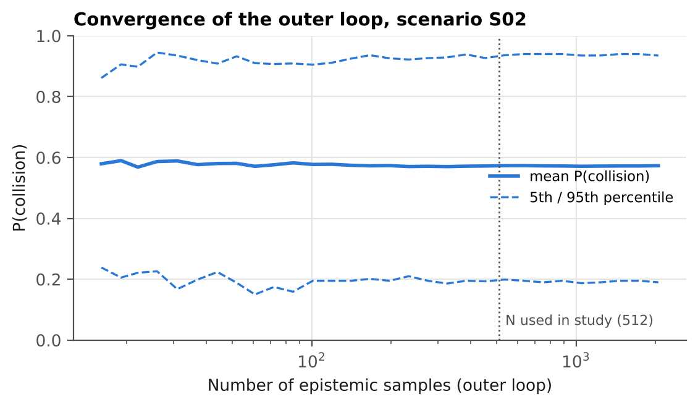{width=82%}

With 512 outer samples, the mean collision probability for S02 is «CONV_512», against «CONV_2048» with 2,048 samples. Beyond about 200 samples the mean changes by less than 0.003, and the 5th and 95th percentiles by less than about ±0.015 (Figure 8). With 200 inner draws, the Monte Carlo standard error on each *P*~c~(θ~i~) is at most 0.035, which is small compared with the epistemic spread. The Sobol bootstrap intervals (Table 8) are narrow compared with the differences between inputs. The conclusions are therefore not artifacts of sample size.

# 9. Discussion

## 9.1 What the results mean for reference-model benchmarking

The deterministic practice answers "does the reference driver avoid this crash?" The more useful question for a safety argument is "with what probability, and how sure are we of that probability?" In nuclear PRA terms, the deterministic run is a single point estimate of an uncertain quantity. The nested analysis gives a full epistemic distribution of an aleatory probability, the format used for core-damage frequencies and for risk-informed decisions (NUREG-1855).

Three consequences follow for ADS evaluation:

1. **Credit should be graded.** An ADS that avoids a conflict which the reference fails with probability 0.95 deserves more credit than one avoiding a conflict the reference fails with probability 0.55. The deterministic method gives both the same credit.
2. **Comparisons need probabilistic support.** When two responders differ by a few conflicts out of 16, the count intervals overlap. A statement such as "the ADS avoids more collisions than the reference with probability *P*" (Eq. 23) is needed.
3. **The reference percentile is a policy lever and should be explicit.** It changes the answer more than the physics does, so it belongs in the acceptance criterion, not hidden in the model.

## 9.2 Relation to Waymo's safety framework

Waymo's acceptance-criteria framework distinguishes event-level from aggregate reasoning, and describes safety as "continuous confidence growth" (Favarò et al., 2023). The quantities produced here fit both:

- *P*~c~ and *p*~flip~ are event-level, but with a stated confidence.
- The count distribution and *P*~ADS>ref~ are aggregate.
- Sobol indices show where new evidence (better reconstructions, a larger response-time dataset) would grow confidence most.

The method could be applied directly to Waymo's existing reconstructions and CAT scenario library, because it needs only the ability to rerun simulations with sampled inputs.

## 9.3 Relation to the wider literature

The study extends probabilistic reconstruction, already used for driver-assistance benefit estimation (Scanlon et al., 2017; Bareiss et al., 2019), in three ways:

1. It adds reference-model parameter uncertainty and driver variability.
2. It separates aleatory from epistemic uncertainty.
3. It adds variance-based sensitivity with interactions.

It also puts into practice the observation of Markkula et al. (2016) and Engström et al. (2024) that response timing depends on the kinematics: RUT, and therefore RT, changes with every sampled reconstruction.

# 10. Limitations and their likely effects

: Table 10. Limitations and their likely effects on the results.

| Limitation | Likely effect on the results | How to address |
|---|---|---|
| Synthetic scenarios, not real reconstructions | The numbers (counts, flip probabilities) are illustrative. The qualitative findings (wide intervals, dominant percentile effect, interactions) should transfer, because they come from the structure of the problem | Apply to real reconstructions (for example Chandler or CISS cases) |
| Only one conflict type (lead-vehicle braking) | Rear-end conflicts give the reference model its best-characterized timing. Crossing-path and VRU conflicts involve more ambiguous stimuli and lateral evasion, and uncertainty there is probably **larger** | Add crossing-path, cut-in and VRU scenarios; use the cut-in model of Engström 2024 |
| Assumed reconstruction ranges (±10/25/20%) | Ranges that are too wide inflate the spread. But halving them changes the count interval little (Table 9), and reconstruction is not the dominant source. Moderate effect | Derive ranges from reconstruction-error studies, or from the evidence available case by case |
| Assumed NIEON braking ranges | Braking has *S*~T~ ≈ 0.23. Narrower true ranges would reduce the spread modestly. The real NIEON also swerves (best of three maneuvers), which would **raise** avoidance, probably increasing the counts | Use the published NIEON evasive profile, if released; add a lateral maneuver model |
| Intercept SE and CV range assumed | These affect the spread in RT. *k*, which is derived, is the dominant timing parameter, so the effect is moderate | Obtain the event-level fit statistics; fit the residual distribution |
| Lognormal residual model | Heavy-tail behavior affects the 90th-percentile results most. A heavier true tail would **lower** the high-percentile counts further | Fit to SHRP2 events, or use the stochastic evidence-accumulation model |
| Linear RT–RUT model outside its data range | Long RUT (gentle conflicts) relies on extrapolation; mainly affects avoided scenarios | Restrict to the fitted RUT range, or use the full model |
| Generic ADS | Says nothing about any real ADS; the robust ranking is a design artifact | Run the method inside a real ADS simulator |
| No ADS failure states | Collision probabilities for the ADS are optimistic; this is the gap the CAT paper notes | Combine with fault trees for degraded sensing and compute (future work) |
| Injury: one anchor, slope assumed, struck occupant only | Injury results are indicative only; negligible here because collision probability dominates | Use full published injury-risk models; include striking occupants and VRUs |
| No other traffic, signal phases or occlusions | Could change avoidance options and secondary collisions | Add surrounding traffic, as Scanlon 2026a suggests |
| Inputs treated as independent | Real reconstruction errors may be correlated (for example speed and gap); Sobol indices assume independence | Use copulas, or dependence-aware sensitivity measures |

# 11. Recommendations

For developers, researchers and evaluators who report reference-model benchmarks:

1. **Report per-scenario probabilities.** Give *P*~c~ with an epistemic interval and the flip probability, not just a binary verdict.
2. **Report counts as distributions.** Give the median and interval of conflicts avoided, and the probability that the ADS outperforms the reference (Eq. 23), instead of comparing two point counts.
3. **Make the reference percentile explicit.** State which percentile of the reference population the acceptance criterion uses, and show the sensitivity to that choice (for example the 10th, 50th and 90th).
4. **Propagate published model uncertainty.** Reference models fitted to data come with sampling uncertainty that can be derived from the fit statistics (Eq. 8). Publishing standard errors and residual distributions alongside reference models would make this routine.
5. **Use variance-based sensitivity analysis, with groups.** It ranks sources, including interactions, and directs data collection to where it reduces uncertainty most. Here that is the lead vehicle's braking and the timing model.
6. **Report the scenario set.** Publish the scenario parameters, or a representative synthetic analog, so that independent researchers can reproduce benchmark uncertainty, in line with the reproducibility goals of the RAVE checklist and of Scanlon et al. (2026b).

# 12. Future work

1. **Real reconstructions.** Apply the framework to reconstructions from public in-depth crash data (for example NHTSA CISS) with case-specific uncertainty ranges.
2. **More conflict types.** Add crossing-path, cut-in and VRU conflicts, with lateral evasive maneuvers and the best-of-three NIEON logic.
3. **Better timing models.** Replace the lognormal residual with the stochastic evidence-accumulation model of Engström et al. (2024), or with a residual fitted to naturalistic data.
4. **Degraded ADS states.** Couple the scenario model with fault trees for degraded sensing and compute, including common-cause failures, to estimate conditional collision probability under failures. CAT currently excludes this case.
5. **Integration into a larger risk model.** Use this module as the behavioral branch of a PRA-style event-tree model for a robotaxi service. The other branches would be initiating conflicts from public crash data, an HRA branch for remote assistance, and consequence binning.
6. **Bayesian updating.** Update the epistemic distributions (for example of *k*) as new naturalistic data become available, putting Waymo's "continuous confidence growth" into numbers.
7. **Dependence among inputs.** Treat correlated reconstruction errors, and use dependence-aware sensitivity measures.

# 13. Conclusions

Counterfactual simulation against a human reference model is one of the few ways to assess ADS performance in severe crashes before billions of miles have accumulated. As currently published, it reports deterministic verdicts and counts. Using Waymo's own published reference-model ingredients and standard PRA uncertainty methods, this report finds:

1. **Deterministic verdicts are probabilities in disguise.** In «FLIP_N» of «N_SCEN» synthetic conflicts the verdict has more than a 20% chance of being reversed.
2. **Benchmark counts carry wide intervals.** The deterministic «DET_N»/16 corresponds to a 90% interval of «CNT_P05» to «CNT_P95», and has only a «P_EQ» probability of being exact.
3. **The reference percentile is the most consequential choice** («REF10», «REF50» and «REF90» avoided at the 10th, 50th and 90th percentiles), and should be an explicit part of the acceptance criterion.
4. **Driver variability dominates the variance**, followed by the published response-time slope, the lead vehicle's braking and the braking model. Interactions are strong, so one-at-a-time sensitivity studies are inadequate.

These additions are inexpensive for any developer with a simulation pipeline. They would turn reference-model benchmarks into probabilistic evidence suitable for a safety case.

# 14. Code, data and reproducibility

**Repository.** `av-counterfactual-uq` (planned public GitHub repository under github.com/mohalbati; MIT license). Its structure:

| Path | Content |
|---|---|
| `src/cfuq/parameters.py` | Every parameter, labeled PUBLISHED, DERIVED or ASSUMED, with source and reasoning; injury model (Eqs. 16–18) |
| `src/cfuq/simulate.py` | Vectorized kinematics, looming and RUT, contact detection (Eqs. 1–6, 11, 14–15); single-run time histories |
| `src/cfuq/models.py` | Reference-driver response time (Eqs. 7–10), generic ADS (Eq. 13), sampling of epistemic inputs, nominal values |
| `src/cfuq/sobol.py` | Saltelli/Jansen estimators with groups and bootstrap (Eqs. 24–27); Ishigami test function |
| `src/cfuq/plots.py` | Figures |
| `scripts/run_analysis.py` | Main analysis: deterministic runs, nested MC, counts, source decomposition, percentiles, Sobol (about 90 s) |
| `scripts/supplementary.py` | Workflow diagram, time histories, convergence (about 25 s) |
| `scripts/concept_figures.py`, `scripts/equation_images.py` | Concept figures A–J, worked example, equation images for the slides |
| `scripts/build_report.py`, `scripts/build_docs.py` | Fill this report's numbers from `results/`; build Word and PDF |
| `simulator/rear-end-sim.html` | Interactive browser simulator (Section 15.1) |
| `scripts/check_simulator.js` | Checks the browser simulator against Python; screenshot |
| `scripts/make_video.py` | Animated video `results/video_S02.mp4` (Section 15.2) |
| `scripts/carla_demo.py`, `RUN_CARLA_DEMO.bat` | CARLA 3D demonstration (Section 15.3); setup in `docs/CARLA_SETUP.md` |
| `scripts/simulator_figures.py` | Figures 9, 11–13 |
| `tests/test_core.py` | Seven verification tests (Section 5.8) |
| `results/` | All CSV tables, `summary.json` and the figures used in this report |
| `docs/` | This report (Markdown source, Word, PDF) |

**Reproduce.**

```
pip install -r requirements.txt        # numpy, scipy, pandas, matplotlib
python tests/test_core.py              # 7 tests
python scripts/run_analysis.py         # writes results/
python scripts/supplementary.py
python scripts/make_video.py           # optional: video (needs FFmpeg)
python scripts/carla_demo.py --dry-run # CARLA demo, model part only
```

**Reproducibility.** All sampling uses fixed seeds (2026 for the main analysis). A clean re-run reproduces `summary.json` and `scenario_results.csv` exactly. The software used was Python 3.13.17, NumPy 2.5.3, SciPy 1.18.1 (`scipy.stats.qmc` for the scrambled Sobol and Latin hypercube designs), pandas 3.0.5 and Matplotlib 3.11.2. Sobol indices are computed with the package's own implementation, verified against Ishigami, so no specialized sensitivity library is needed.

**Relation to other work by the author.** A companion repository (`av-safety-bayesian-analysis`; DOI 10.5281/zenodo.23732384) reconstructs Waymo's rider-only crash record from public NHTSA data and analyzes it with Bayesian rare-event methods. The present module is the first piece of a planned integrated, PRA-style risk model for driverless fleets.

# 15. Simulators for checking and demonstrating the models

*In plain words.* Tables and probability curves convince specialists, but most people understand a crash only when they can see it. Three tools were therefore built on top of the analysis: a simulator that runs in a web browser, an animated video, and a 3D demonstration in the CARLA driving simulator. All three use the same equations and parameters as Sections 5 and 6, so what they show is the report's model, not a new one. They add no new evidence; they make the model visible, let anyone try their own numbers, and provide an independent check that the code does what the equations say.

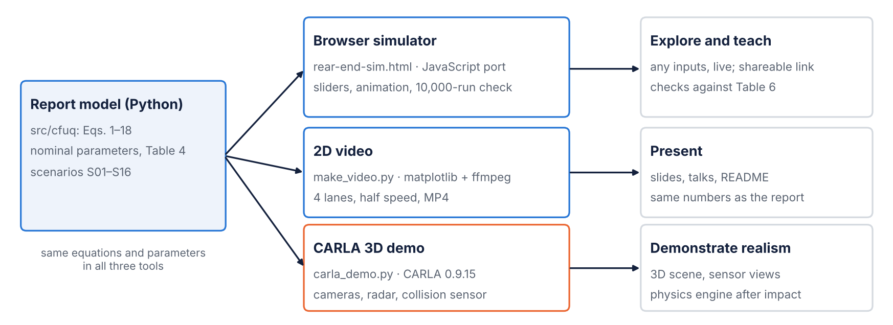{width=100%}

: Table 11. The three tools compared.

| | Browser simulator | 2D video | CARLA 3D demonstration |
|---|---|---|---|
| File | `simulator/rear-end-sim.html` | `scripts/make_video.py` → `results/video_S02.mp4` | `scripts/carla_demo.py` (+ `RUN_CARLA_DEMO.bat`) → `results/carla_<scenario>.mp4` |
| Technology | One HTML page with JavaScript; no installation | Python, Matplotlib, FFmpeg | Python client for CARLA 0.9.15 (Unreal Engine 4) |
| Inputs | Any value, by sliders, or presets S01–S16 | Scenario, playback speed | Scenario or own numbers, up to four drivers, weather, map |
| Outputs | Animation, gauges, gap and speed charts, verdicts, 10,000-replay uncertainty check | 1920×1080 MP4 of four drivers | 1920×1080 MP4 with drone, chase and dash cameras, radar and telemetry |
| Run time | Instant; uncertainty check about 1 s | About 90 s | About 2–5 min, plus loading the simulator |
| Needs | A web browser | Python and FFmpeg | Windows or Linux with an NVIDIA GPU (8 GB recommended) |

## 15.1 Interactive browser simulator

**What the user sees.** The page (Figure 10) opens on scenario S02 and plays the conflict at real speed. A top-down road view follows the lead car. Each follower lane shows its car, brake lights, the live gap in metres and a status ("not braking yet", "braking 7.5 m/s²", "stopped 11.2 m short" or "impact at 25 km/h"). Under the road are live gauges, gap and speed charts with the response time marked, and a one-line verdict per lane with the closing speed, delta-v and serious-injury probability. Playback can be paused, slowed to 0.25× or scrubbed.

{width=92%}

**Controls.** Every model input can be set by hand:

: Table 12. Controls of the browser simulator and the equations they feed.

| Group | Controls (range) | Feeds |
|---|---|---|
| Crash reconstruction | Initial speed (20–140 km/h), time headway (0.2–3 s), lead deceleration (2–10 m/s²), lead jerk (2–30 m/s³); or a preset S01–S16 | Eqs. (1)–(6) |
| Reference driver | Response time as *mean driver*, *percentile driver* (1st–99th, with CV 0.1–0.8) or *manual* (0.2–4 s); intercept *m*, slope *k*; maximum deceleration (3–10 m/s²), jerk (5–40 m/s³) | Eqs. (7)–(11) |
| Generic ADS | Show/hide lane; latency (0.1–2 s), maximum deceleration, jerk | Eqs. (11), (13) |
| Injury curve | Steepness *R*~50~ (1.2–2.0) | Eqs. (16)–(18) |

**How it was generated.** The page is a single self-contained HTML file with inline JavaScript and no external code, so it runs offline and can be shared as a link. Its model functions are a line-by-line port of the Python package:

- `rampUp` implements Eqs. (4)–(6) with the follower at constant speed, as `ramp_up_time` does.
- `rtModel` implements Eqs. (7) and (10). The percentile driver uses the inverse normal distribution (Acklam's algorithm) to turn a percentile into *z*.
- `traj` integrates Eqs. (1)–(3) and (11) with the same 5 ms step, trapezoidal positions and linear interpolation of the contact instant (Eqs. 14–15).
- `injury` implements Eqs. (16)–(18).

When an input changes, the page recomputes both trajectories (about 1,000 steps each), then animates them with the browser's frame clock at the chosen playback speed. After contact the two cars are drawn locked together, because post-impact motion is outside the model.

**The uncertainty check.** The button runs a reduced version of the nested Monte Carlo of Section 6.2: 200 outer samples (states of knowledge) × 50 inner samples (drivers) = 10,000 replays. The ranges are the report's half-widths (Table 4), centred on the values the user has set:

- speed ±10%, headway ±25%, lead deceleration ±20%, lead jerk 5–20 m/s³;
- intercept SE 0.10 s, slope SE 0.122;
- CV ±0.15, braking ±1 m/s² and ±10 m/s³, ADS latency ±0.25 s.

At the default settings this reproduces the main analysis for the scenario shown. It differs from the main analysis in three ways: it uses a seeded pseudo-random generator (mulberry32, seed 2026, with Box–Muller normals) instead of scrambled Sobol points, 50 inner draws instead of 200, and 200 outer samples instead of 512. Its results therefore agree with Table 6 within Monte Carlo error (about ±0.03), not exactly.

**Verification.** The page was checked against the Python package with a headless browser (`scripts/check_simulator.js`), which also takes the screenshot in Figure 10.

: Table 13. Scenario S02 computed by the Python package and by the browser simulator.

| Quantity | Python (report) | Browser simulator |
|---|---|---|
| Ramp-up time (s) | «W_RUT» | «JS_RUT» |
| Mean-driver response time (s) | «W_RT» | «JS_RT» |
| 10th / 90th-percentile response time (s) | «W_RT10» / «W_RT90» | «JS_RT10» / «JS_RT90» |
| Closing speed at contact (km/h) | «W_VC» | «JS_VC» |
| Serious-injury probability at contact | «PY_PINJ» | «JS_PINJ» |
| ADS minimum gap (m) | «PY_ADSGAP» | «JS_ADSGAP» |
| Reference P(collision), mean (5th–95th) | «S02_MEAN» («S02_P05»–«S02_P95») | «JS_MC» («JS_MCB») |
| Flip probability | «PY_FLIP» | «JS_FLIP» |
| ADS P(collision) | «PY_ADSP» | «JS_ADSP» |

The deterministic quantities agree to the last digit shown. The probabilistic ones agree within the Monte Carlo error expected from the smaller sample.

**How it was used.**

- **Checking.** Table 13 is an independent re-implementation of the model in a second language. Agreement confirms that the Python code follows the equations.
- **Exploring.** Moving the percentile slider for S02 shows the result of Section 8.5 directly: the 10th-percentile driver stops 11 m short, the median driver just hits, and the 90th-percentile driver hits at about 49 km/h. Raising the headway of S02 from 0.92 s to 1.2 s does not save the mean driver: the larger gap also lengthens the ramp-up time, so the response comes later (1.68 s instead of 1.47 s) and the closing speed stays near 27 km/h. This is the kinematics-dependent timing effect of Section 7.2, made visible.
- **Explaining.** The page lets a reader without Python test "what if the driver were faster?" or "what if the gap were 1.5 s?" and see the uncertainty check change with it.

## 15.2 Animated video

**What it shows.** `results/video_S02.mp4` (Figure 11) shows scenario S02 at half speed in four lanes that share the same lead car: the 10th-percentile, mean and 90th-percentile reference drivers and the generic ADS. Each lane shows the cars, brake lights, the gap and a status line. Gap and speed charts grow underneath as the conflict unfolds.

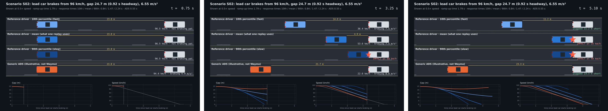{width=100%}

**How it was generated.** `scripts/make_video.py`:

1. Reads the scenario's exact inputs from `results/scenario_results.csv`.
2. Computes the ramp-up time with the package's `ramp_up_time` and the three response times with `nieon_response_time` (Eqs. 7 and 10; CV = 0.40; *z* = ±1.2816 for the 10th and 90th percentiles).
3. Integrates each lane with Eqs. (1)–(3), (11) and (14)–(15) at 5 ms steps.
4. Draws every frame with Matplotlib: car shapes, a camera that follows the lead car, and moving lane marks to show speed.
5. Writes 30 frames per second through FFmpeg (H.264, CRF 20, `veryfast` preset, yuv420p) at 1920×1080. Playback is at 0.5×, with a 2.5 s title hold and a 3.5 s end hold: 485 frames in about 90 s of computing time.

**What it shows numerically.** The 10th-percentile driver stops about 11 m short, the mean driver hits at «W_VC» km/h, the 90th-percentile driver hits at about 49 km/h, and the ADS never comes closer than «PY_ADSGAP» m. These are the worked example of Section 5.9, shown as motion.

**How it was used.** In the slide deck, the README and talks, to show in 16 seconds why a single replay hides the spread of possible outcomes. Other scenarios can be rendered with `python scripts/make_video.py --scenario S09 --slow 0.25`.

## 15.3 CARLA 3D demonstration

**What CARLA is.** CARLA is an open-source simulator for autonomous-driving research built on Unreal Engine (Dosovitskiy et al., 2017). It provides towns and highways, vehicle physics, and sensors such as cameras, radar, lidar and collision detectors. It runs as a server, and Python scripts connect to it as clients. Version 0.9.15 was used, the latest Unreal Engine 4 release, whose documentation recommends a dedicated GPU equivalent to an NVIDIA RTX 2070 or better with at least 8 GB of video memory (CARLA Team, 2023). The newer Unreal Engine 5 version asks for 16 GB.

**Hardware check.** Before installation, the author's laptop was checked with the Windows DirectX diagnostic tool (`dxdiag /t`):

: Table 14. The author's laptop against the CARLA 0.9.15 requirements.

| | Author's laptop | CARLA 0.9.15 |
|---|---|---|
| GPU | NVIDIA GeForce RTX 4060 Laptop, 8 GB | RTX 2070 or better, 8 GB recommended |
| CPU, RAM | Intel i7-13650HX (20 threads), 16 GB | not limiting |
| Free disk | 518 GB | about 20 GB |
| Operating system | Windows 11 | Windows 10/11 or Ubuntu 20.04/22.04 |
| Python | 3.10 (installed for CARLA) | Windows client packages for Python 3.7–3.10 only |

The laptop also has Intel integrated graphics, so CARLA is set in Windows graphics settings to run on the NVIDIA card. The installed package contains Town01–05 and Town10HD; the script uses the Town04 highway.

**How it was generated.** `scripts/carla_demo.py` runs one synchronous simulation per video. Figure 12 shows the six steps of each tick.

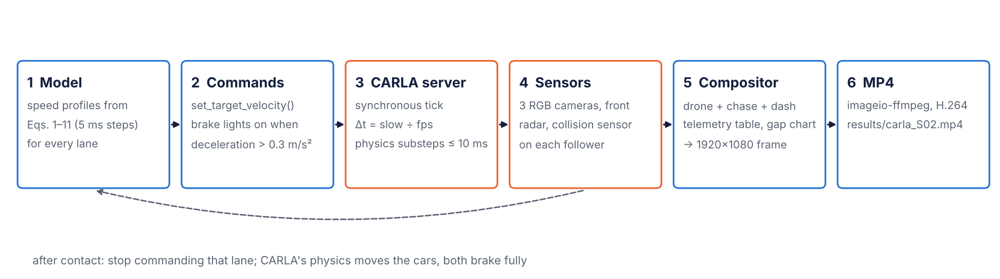{width=100%}

1. **Model.** For each lane, the script computes the lead and follower speed profiles from Eqs. (1)–(11) at 5 ms steps, with the same nominal parameters as the report:
   - ramp-up time from Eqs. (4)–(6);
   - response time from Eqs. (7) and (10) for the chosen driver (`mean`, a percentile such as `p10`, a manual value such as `rt:1.2`, or `ads` with Eq. 13);
   - braking from Eq. (11) with *a*~max~ = 7.5 m/s² and *j* = 20 m/s³ for the reference drivers, and 8 m/s² and 30 m/s³ for the ADS.

   The follower's profile is computed without the contact stop, so that CARLA, not the model, decides whether and when the cars touch. A `--dry-run` option prints the model's own outcome. For S02 it gives a contact at 3.91 s and «W_VC» km/h for the mean driver, matching Table 4a.
2. **Road.** The script searches the map for a straight stretch with enough lanes in one direction. A candidate is accepted if the heading changes by no more than 6° over the distance the cars will travel: 40 m + 1 s of warm-up + the lead car's stopping distance + 30 m ahead, and the initial gap + 20 m behind. Each driver gets its own lane, with an identical lead car.
3. **Vehicles and sensors.** In each lane, a lead car (Lincoln MKZ) and a follower (Tesla Model 3, coloured by driver) are placed with their bumpers exactly *h*·*v*~0~ apart, using CARLA's bounding boxes. Each follower carries:
   - a collision sensor;
   - a front radar (8° × 4° field of view, 100 m range, 3,000 points per second);
   - for the focus driver, a chase camera (7 m behind, 2.8 m up) and a dashcam (on the hood).

   A drone camera (1280×720, 70° field of view) flies behind and above the group.
4. **Simulation.** CARLA runs in synchronous mode with a fixed step of (playback speed ÷ frame rate) seconds: 1/60 s at half speed, with physics substeps of at most 10 ms. After a 1 s warm-up at constant speed, every tick does three things:
   - sets each car's velocity to the model's speed at that instant;
   - turns brake lights on when deceleration exceeds 0.3 m/s²;
   - advances the simulator.

   When a follower's collision sensor fires, the script stops commanding that lane. Both cars brake fully and CARLA's physics computes the crash and what follows.
5. **Compositor.** Each frame combines the three camera images, a telemetry table and a live gap chart (Figure 13). The table shows each lane's response time, speed, true gap, radar range and status, computed from CARLA's vehicle positions.
6. **Video.** Frames are written through imageio-ffmpeg as H.264 at 30 frames per second.

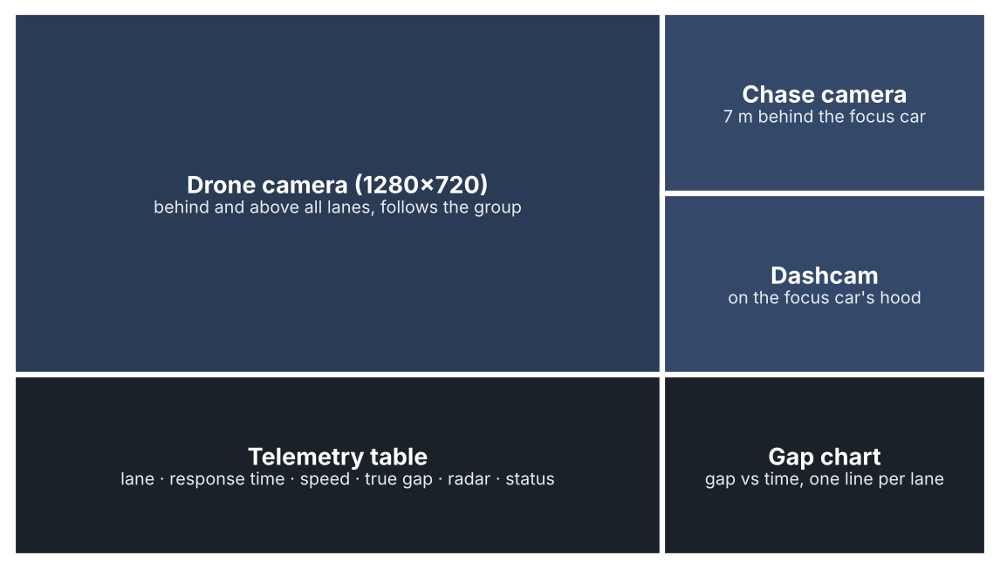{width=70%}

**Running it.** `RUN_CARLA_DEMO.bat` (Windows) automates the steps: it checks for Python 3.10, installs the client packages on the first run, starts the simulator, waits for it to load and runs the script. Options select the scenario or custom inputs (`--speed`, `--headway`, `--decel`), the drivers, the focus lane, the weather (for example `HardRainNoon`), the map and the playback speed. `docs/CARLA_SETUP.md` gives the full setup.

**How it relates to the model.** The speeds are the model's; the positions, contact and post-impact motion are CARLA's. Because CARLA integrates vehicle motion with its own physics and tyre model, gaps can differ from the model by a few tenths of a metre, and contact can occur a few milliseconds earlier or later. The model's prediction is printed next to CARLA's result, so any difference is visible. The radar column shows how a perception system would measure the same gap: the difference between radar range and true gap is a small, concrete example of the sensing uncertainty that the report does not model (Section 10).

**How it is used.**

- **Demonstration.** A realistic 3D view for audiences who do not read equations.
- **Sensor view.** Camera and radar data show what an ADS would see in the same conflict.
- **Platform for future work.** It is a starting point for the extensions in Section 12: other conflict types, steering manoeuvres, weather, and perception uncertainty with sampled sensor noise.

The script's model part has been verified (dry-run output equal to Table 4a). The full 3D run is made on the author's laptop and writes `results/carla_S02.mp4`.

## 15.4 What the simulators do and do not show

- **Same assumptions as the report.** They share all the report's assumptions (Section 6.7): braking only, no swerving, a generic ADS that is not Waymo's system, and no other traffic.
- **Illustrations, not evidence.** They do not validate the model. Agreement between the Python, JavaScript and CARLA outputs shows that the code is consistent, not that the model is right.
- **CARLA is not a crash-reconstruction tool.** Its vehicle dynamics are generic and its post-impact motion is indicative only.
- **The browser check is smaller.** Its uncertainty check is a reduced Monte Carlo; the numbers in Sections 8.1–8.5 come from the full analysis.

# References

- Acklam, P. J. (2003). An algorithm for computing the inverse normal cumulative distribution function. Technical note, web.archive.org/web/2003*/home.online.no/~pjacklam/notes/invnorm.
- Bareiss, M., Scanlon, J., Sherony, R., Gabler, H. C. (2019). Crash and injury prevention estimates for intersection driver assistance systems in left turn across path/opposite direction crashes in the United States. *Traffic Injury Prevention* 20(sup1), S133–S138.
- Campolettano, E. T., Scanlon, J. M., McMurry, T. L., Kusano, K. D., Victor, T. (2025). TARGET setting for high severity collisions: tolerance-based assessment of risk for generalized event thresholds. *Traffic Safety Research* 9. doi:10.55329/wxoa2712
- CARLA Team (2023). *CARLA Simulator documentation, release 0.9.15: Quick start package installation.* carla.readthedocs.io.
- Der Kiureghian, A., Ditlevsen, O. (2009). Aleatory or epistemic? Does it matter? *Structural Safety* 31(2), 105–112.
- Dosovitskiy, A., Ros, G., Codevilla, F., López, A., Koltun, V. (2017). CARLA: An open urban driving simulator. *Proceedings of the 1st Conference on Robot Learning (CoRL)*, PMLR 78, 1–16.
- Engström, J., Liu, S.-Y., Dinparastdjadid, A., Simoiu, C. (2024). Modeling road user response timing in naturalistic traffic conflicts: A surprise-based framework. *Accident Analysis & Prevention* 198, 107460. (Preprint 2022: arXiv:2208.08651.)
- Favarò, F., Fraade-Blanar, L., Schnelle, S., Victor, T., Peña, M., Engström, J., Scanlon, J., Kusano, K., Smith, D. (2023). Building a credible case for safety: Waymo's approach for the determination of absence of unreasonable risk. arXiv:2306.01917.
- Green, M. (2000). "How long does it take to stop?" Methodological analysis of driver perception-brake times. *Transportation Human Factors* 2(3), 195–216.
- Gruber, M., et al. (2019). As cited in Scanlon et al. (2021): prospective safety assessment of automated driving using reconstructed in-depth crash data.
- Hamdane, H., Serre, T., Masson, C., Anderson, R. (2015). Issues and challenges for pedestrian active safety systems based on real world accidents. *Accident Analysis & Prevention* 82, 53–60.
- Helton, J. C., Johnson, J. D., Oberkampf, W. L. (2004). An exploration of alternative approaches to the representation of uncertainty in model predictions. *Reliability Engineering & System Safety* 85, 39–71.
- Homma, T., Saltelli, A. (1996). Importance measures in global sensitivity analysis of nonlinear models. *Reliability Engineering & System Safety* 52, 1–17.
- Ishigami, T., Homma, T. (1990). An importance quantification technique in uncertainty analysis for computer models. *Proc. ISUMA '90*, 398–403.
- Jansen, M. J. W. (1999). Analysis of variance designs for model output. *Computer Physics Communications* 117, 35–43.
- Kalra, N., Paddock, S. M. (2016). *Driving to Safety: How Many Miles of Driving Would It Take to Demonstrate Autonomous Vehicle Reliability?* RAND RR-1478-RC.
- Kusano, K. D., Gabler, H. C. (2012). Safety benefits of forward collision warning, brake assist, and autonomous braking systems in rear-end collisions. *IEEE Trans. Intelligent Transportation Systems* 13(4), 1546–1555.
- Kusano, K. D., Beatty, K., Schnelle, S., Favarò, F., Crary, C., Victor, T. (2022/2026). Collision avoidance testing of the Waymo automated driving system. arXiv:2212.08148; SAE 2026-01-0519.
- Kusano, K. D., et al. (2024). Comparison of Waymo rider-only crash data to human benchmarks at 7.1 million miles. *Traffic Injury Prevention* 25(sup1), S66–S77.
- Kusano, K. D., Scanlon, J. M., Chen, Y.-H., McMurry, T. L., Gode, T., Victor, T. (2025). Comparison of Waymo rider-only crash rates by crash type to human benchmarks at 56.7 million miles. *Traffic Injury Prevention* 26(sup1).
- Lee, D. N. (1976). A theory of visual control of braking based on information about time-to-collision. *Perception* 5(4), 437–459.
- Markkula, G., Engström, J., Lodin, J., Bärgman, J., Victor, T. (2016). A farewell to brake reaction times? Kinematics-dependent brake response in naturalistic rear-end emergencies. *Accident Analysis & Prevention* 95, 209–226.
- McKay, M. D., Beckman, R. J., Conover, W. J. (1979). A comparison of three methods for selecting values of input variables in the analysis of output from a computer code. *Technometrics* 21(2), 239–245.
- Saltelli, A., Annoni, P., Azzini, I., Campolongo, F., Ratto, M., Tarantola, S. (2010). Variance based sensitivity analysis of model output: design and estimator for the total sensitivity index. *Computer Physics Communications* 181, 259–270.
- Scanlon, J. M., Sherony, R., Gabler, H. C. (2017). Injury mitigation estimates for an intersection driver assistance system in straight crossing path crashes in the United States. *Traffic Injury Prevention* 18(sup1), S9–S17.
- Scanlon, J. M., Kusano, K. D., Daniel, T., Alderson, C., Ogle, A., Victor, T. (2021). Waymo simulated driving behavior in reconstructed fatal crashes within an autonomous vehicle operating domain. *Accident Analysis & Prevention* 163, 106454.
- Scanlon, J. M., Kusano, K. D., Engström, J., Victor, T. (2026a). Collision avoidance effectiveness of an automated driving system using a human driver behavior reference model in reconstructed fatal collisions. SAE 2026-01-0520.
- Scanlon, J. M., Kusano, K. D., McMurry, T. L., Campolettano, E. T., Victor, T. (2026b). High-resolution urban fatal crash rate benchmarks for automated driving system assessment. *Traffic Injury Prevention* 27(sup1), S251–S262.
- Scanlon, J. M., Teoh, E. R., Kidd, D. G., et al. (2025). RAVE checklist: Recommendations for overcoming challenges in retrospective safety studies of automated driving systems. *Traffic Injury Prevention* 26(5), 608–621.
- Schachner, M., et al. (2020). As cited in Scanlon et al. (2021, 2026a): probabilistic crash reconstruction for counterfactual simulation.
- Schnelle, S., Favarò, F. (2023). ADS standardization landscape: Making sense of its status and of the associated research questions. arXiv:2306.17682.
- Schwall, M., Daniel, T., Victor, T., Favarò, F., Hohnhold, H. (2020). Waymo public road safety performance data. arXiv:2011.00038.
- Shalev-Shwartz, S., Shammah, S., Shashua, A. (2017). On a formal model of safe and scalable self-driving cars. arXiv:1708.06374.
- Sobol, I. M. (2001). Global sensitivity indices for nonlinear mathematical models and their Monte Carlo estimates. *Mathematics and Computers in Simulation* 55, 271–280.
- UNECE (2021). UN Regulation No. 157: Automated Lane Keeping Systems (as cited by Engström et al., 2024).
- U.S. Nuclear Regulatory Commission (2017). *Guidance on the Treatment of Uncertainties Associated with PRAs in Risk-Informed Decisionmaking*, NUREG-1855 Rev. 1.
- Webb, N., Smith, D., Ludwick, C., Victor, T., Hommes, Q., Favarò, F., Ivanov, G., Daniel, T. (2020). Waymo's safety methodologies and safety readiness determinations. arXiv:2011.00054.

# Appendix A. Symbols

| Symbol | Meaning | Unit |
|---|---|---|
| *v*~0~, *v*~L~, *v*~S~ | Initial, lead-vehicle and subject-vehicle speed | m/s |
| *h*, *x*, *x*~0~ | Time headway; gap; initial gap | s; m; m |
| *a*~L~, *j*~L~ | Lead deceleration and jerk | m/s²; m/s³ |
| *a*~S~, *a*~max~, *j* | Responder deceleration, maximum, jerk | m/s²; m/s²; m/s³ |
| θ, θ̇, θ̇* | Visual angle, looming rate, looming threshold | rad; rad/s |
| *W*, *D*, *d*~eye~ | Lead width; eye-to-lead distance; eye offset | m |
| RUT, RT, *m*, *k* | Ramp-up time, response time, regression intercept and slope | s; s; s; – |
| *r*, *n* | Correlation and sample size of the response-time fit | – |
| ε, *z*, CV, *s* | Multiplicative residual, standard-normal residual, coefficient of variation, log-SD | – |
| τ~ADS~ | ADS latency | s |
| *C*, *t*~c~, *v*~c~, Δ*v* | Collision indicator, contact time, closing speed, delta-v | –; s; m/s; km/h |
| *b*~0~, *b*~1~, *R*~50~, Δ*v*~10~ | Injury-curve coefficients, slope ratio, 10%-risk delta-v | –; 1/(km/h); –; km/h |
| θ (vector), *N*~O~, *N*~I~ | Epistemic input vector; outer and inner sample sizes | – |
| *P*~c~, *p*~flip~, *N*~av~ | Conditional collision probability, flip probability, count avoided | – |
| *S*~i~, *S*~Ti~ | First-order and total Sobol indices | – |
