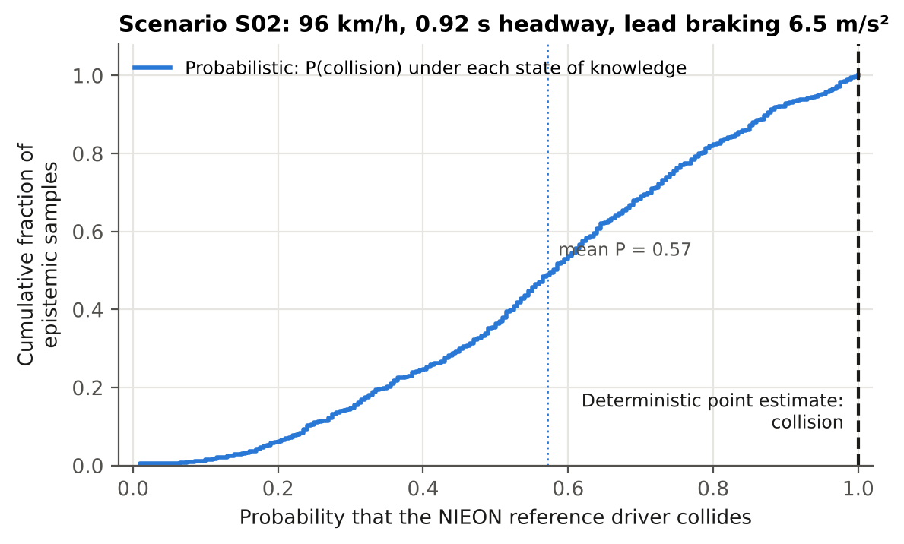
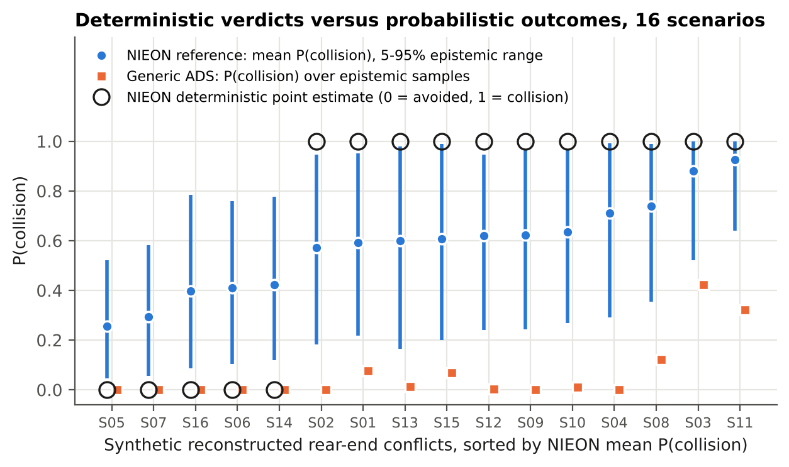
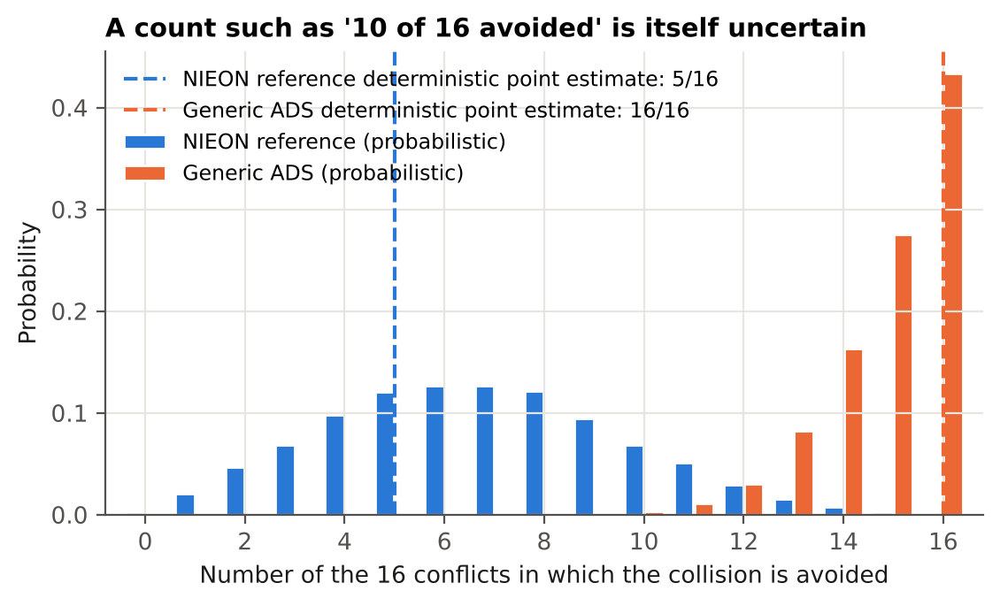
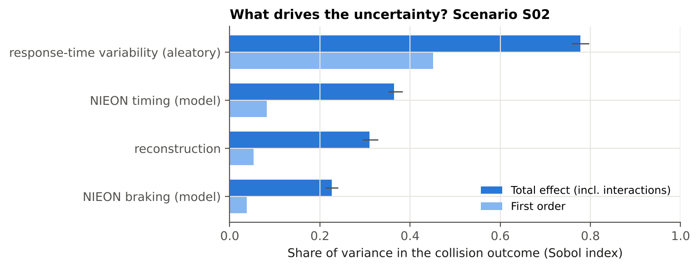
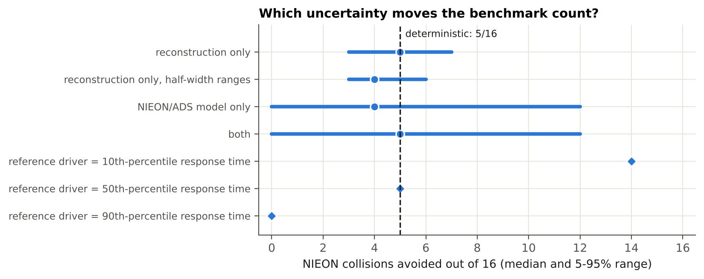

# Summary

Waymo benchmarks its driver against a human reference model called NIEON (Non-Impaired, Eyes ON the conflict). Both are simulated in reconstructed real crashes, and each run is scored as collision avoided or not. Each crash is simulated once, from a single deterministic reconstruction and a point-estimate reference response time. In 2021 the authors put reconstruction and performance uncertainty out of scope and named uncertainty modeling as future work (Scanlon et al., 2021). In 2026 it is still listed as future work (Scanlon et al., 2026).

This note puts that step into practice, using Waymo's own published response-time model (Engström et al., 2024) and injury threshold (Campolettano et al., 2025). It applies the uncertainty treatment standard in nuclear probabilistic risk assessment (PRA): a two-loop Monte Carlo that separates epistemic from aleatory uncertainty, plus variance-based (Sobol) sensitivity analysis. It is tested on 16 synthetic rear-end conflicts in which the lead vehicle brakes hard.

**Findings (synthetic scenarios, stated assumptions):**

1. **Single-run verdicts are fragile.** In 14 of 16 conflicts, the deterministic "avoided / not avoided" verdict for the reference driver has more than a 20% probability of being reversed once reasonable uncertainty is included.
2. **A benchmark count is a distribution, not a number.** The deterministic run gives 5 of 16 collisions avoided by the reference driver. With uncertainty, the 90% interval is 2 to 12 (median 7). The probability that the true count equals the deterministic one is only 12%.
3. **The choice of reference driver dominates.** Using the 10th, 50th or 90th percentile of the published response-time distribution gives 14, 5 and 0 of 16 collisions avoided. That choice is a policy decision, and it moves the result more than any physical uncertainty does.
4. **Reconstruction uncertainty matters but is not the largest source.** Reconstruction uncertainty alone gives a range of 3 to 7. Halving the assumed reconstruction errors narrows it only to 3 to 6.
5. **The single most influential published parameter is the response-time slope.** Its standard error, derived from the paper's own statistics (0.47 ± 0.12 s per s), has a total Sobol index of 0.31. Most variance enters through interactions, so one-at-a-time sensitivity studies would miss it.

**What this means for Waymo-style evaluation.** A reference-model benchmark is most defensible when it is reported as (a) the probability of avoidance for each scenario, with an interval, (b) a count with an interval, and (c) results for an explicitly chosen reference percentile. All three are cheap to add to an existing simulation pipeline.

# 1. Background

**Counterfactual benchmarking.** In the responder role, the ADS reacts to another road user's sudden, unexpected action. Waymo evaluates this role with two published methods:

- **Collision Avoidance Testing.** Over 13,000 scenarios; the acceptance criterion is to match or exceed NIEON (Kusano et al., 2022/2026).
- **Reconstructed fatal crashes.** Chandler, Arizona crashes (Scanlon et al., 2021, 2026). In the 2026 study, of 16 conflicts entered, the Waymo Driver prevented 12 and NIEON 10.

**What the authors say is missing.**

- **2021 study.** Uncertainty from the reconstructions and from ADS performance was out of scope, and future work would add uncertainty modeling to the simulation protocol.
- **2026 study.** Each crash used a single representation of the reconstruction, although documentation varied between cases. NIEON used a point estimate of response time. Probabilistic reconstruction and alternative reference-model parameters are listed as future work.

**The available inputs.** Engström et al. (2024) fit NIEON response timing to 36 SHRP2 rear-end conflicts:

RspT = 0.63 s + 0.47 · RUT

RUT is the ramp-up time from the surprising stimulus onset until visual looming reaches 0.05 rad/s. The fit has a correlation of 0.55, and the residuals are positively skewed and heteroscedastic. The statistics needed for an uncertainty analysis are therefore published, even though they have not been used for one.

# 2. Method

## 2.1 Scenario and physics

A subject vehicle follows a lead vehicle at the same speed *v*₀ and time headway *h*. At *t* = 0 the lead vehicle brakes: its deceleration ramps up with jerk *j*_L to *a*_L and holds until it stops. The responder keeps its speed until its response time, then brakes with a jerk-limited ramp to *a*_max. The equations of motion are integrated at 5 ms steps, with linear interpolation to the instant of contact. The outputs are collision (yes or no), closing speed at contact and minimum gap.

**Reference driver (NIEON type).** Response time is computed from the published regression. RUT is computed from the simulated looming signal, θ̇ = *W*·*v*_closing / (*d*² + *W*²/4), with *W* = 1.8 m.

**Generic ADS.** It reacts a fixed latency after the lead vehicle starts to decelerate. This is an *illustrative* model, not Waymo's system; it exists only to show how a comparison between two drivers behaves under uncertainty.

**Injury.** Struck-occupant MAIS3+ risk is a logistic function of delta-v, anchored on the TARGET rear-end threshold: 10% risk at 126 km/h closing speed, which is 63 km/h delta-v for equal masses. The slope is epistemic (Table 1).

## 2.2 Uncertainty structure

Following PRA practice, uncertainty is split into two types:

- **Epistemic** (state of knowledge, outer loop, 512 scrambled Sobol samples): what the reconstruction really was, and the parameters of the reference and ADS models.
- **Aleatory** (variability, inner loop, 200 draws): differences in response time between individual drivers in the NIEON cohort. These are the regression residual.

The deterministic practice corresponds to every epistemic input at its nominal value and the residual set to zero, giving the "mean driver".

: Table 1. Inputs, values and sources. P = published; D = derived from published numbers; A = assumed, with the range tested.

| Input | Nominal / distribution | Type | Source or reasoning |
|---|---|---|---|
| Response-time intercept *m* | 0.63 s, SE 0.10 s | P / A | Engström 2024; SE not reported, assumed |
| Response-time slope *k* | 0.47, SE 0.122 | P / D | SE(*k*) = *k*·√((1−*r*²)/(*r*²(*n*−2))) with *r* = 0.55, *n* = 36; gives *t* = 3.85, consistent with the reported *p* < 0.001 |
| Residual (driver variability) | lognormal, unit mean, CV 0.25–0.55 | D / A | *r*² = 0.30 means residual SD = 0.835·SD(RspT); skew and heteroscedasticity as reported |
| Looming threshold | 0.05 rad/s | P | Engström 2024 |
| Reference braking *a*_max, jerk | 6.5–8.5 m/s², 10–30 m/s³ | A | NIEON braking profile not published in the reviewed papers |
| Initial speed | ±10% | A | Police-report reconstruction quality varies (Scanlon 2021, 2026) |
| Initial headway | ±25% | A | as above |
| Lead deceleration | ±20%; jerk 5–20 m/s³ | A | as above |
| ADS latency, *a*_max, jerk | 0.3–0.8 s, 7–9 m/s², 20–40 m/s³ | A | Illustrative generic ADS |
| Injury slope (ratio of 50% to 10% delta-v) | 1.3–1.8 | A | Anchored on the TARGET threshold (P) |

**Scenarios.** Sixteen synthetic rear-end conflicts were drawn by Latin hypercube from 40–112 km/h, 0.3–1.6 s headway and 5.5–9.5 m/s² lead deceleration. They stand in for police-report reconstructions; they are *not* real crashes.

**Sensitivity.** Sobol first-order and total indices were computed with the Saltelli/Jansen estimators (base sample 8,192, bootstrap confidence intervals), for individual inputs and for groups of inputs. The estimator is verified against the analytic Ishigami values in the test suite.

# 3. Results

## 3.1 One scenario: a deterministic "collision" is a 57% probability

{width=88%}

Each point on the curve in Figure 1 is one state of knowledge about the reconstruction and the model, and gives the probability of a collision across the driver population. The deterministic verdict sits at the extreme right of this distribution. That is not a bias in the deterministic method; it is the expected result of reducing a continuous risk to a single yes-or-no answer.

## 3.2 Sixteen scenarios

{width=95%}

Every deterministic "collision" corresponds to a mean collision probability between 0.57 and 0.92. Every deterministic "avoided" corresponds to a probability between 0.25 and 0.42 (Figure 2). In 14 of 16 scenarios the verdict flips with probability above 0.2. Even under the narrower "mean driver" view, with epistemic uncertainty only, this holds in 9 of 16. Full results are in `results/scenario_results.csv`.

## 3.3 Scenario-set counts

{width=88%}

The headline statistic in reference-model benchmarking is a count, such as "12 of 16 prevented versus 10 of 16". In Figure 3 that count for the reference driver has a 90% interval of 2 to 12 around a deterministic value of 5. The illustrative ADS gets 13 to 16 (deterministic 16). With a large performance gap the ranking is robust: the ADS avoids more collisions in 99.6% of realizations. If the gap were small, as in the published 12 versus 10, a probabilistic statement would be needed to support the ranking.

## 3.4 Where the uncertainty comes from

{width=85%}

{width=88%}

**Grouped Sobol indices for scenario S02 (Figure 4).** Driver-to-driver variability in response time has a total index of 0.78. The response-time model parameters have 0.36; the slope alone has 0.31, the largest individual epistemic input, and it is fully determined by published statistics. The reconstruction has 0.31, with lead deceleration 0.28. The braking model has 0.23. The total indices are far larger than the first-order indices, so most of the variance comes from interactions. A collision is a threshold event, and its outcome depends on how timing, braking and kinematics combine. This is why one-at-a-time sensitivity checks understate the uncertainty.

**The count under each uncertainty source (Figure 5).** Reconstruction uncertainty alone gives 3 to 7 avoided, and halving its assumed ranges gives 3 to 6. Model uncertainty alone gives 0 to 12. Choosing the 10th, 50th or 90th response-time percentile as "the" reference driver gives 14, 5 or 0. The reference percentile is a policy choice of acceptable human performance. It should be set and reported explicitly, as Scanlon et al. (2026) suggest when they propose exploring other reference-model parameters.

**Injury.** At these speeds, rear-end closing speeds stay well below the TARGET threshold. The mean probability of MAIS3+ is at most 0.9% per scenario (95th percentile 2.2%), so the collision outcome rather than injury severity dominates this example. The injury layer becomes informative for crossing-path and vulnerable-road-user scenarios.

# 4. Discussion

**Recommendations for reference-model benchmarking:**

1. Report each scenario as a probability of avoidance with an interval, not a yes or no.
2. Report the benchmark count as a distribution, and state the probability that the ADS outperforms the reference, rather than comparing two point counts.
3. State the reference percentile explicitly and show the sensitivity to it.
4. Propagate the published uncertainty of the reference model's parameters; for NIEON timing, it is available from the fitting statistics.
5. Treat reconstruction inputs probabilistically, as already proposed in the literature the papers cite (Bareiss et al., 2019; Schachner et al., 2020).
6. Use variance-based sensitivity analysis, which captures the interactions, to decide where better reconstruction or better reference models would reduce uncertainty most.

**Link to PRA practice.** The two-loop separation is the same one used in nuclear PRA. Epistemic uncertainty gives a family of curves, and aleatory variability gives the shape of each curve. The result is a statement such as "with 95% confidence, the probability of avoidance is at least *x*", which fits the "level of aggregation" and "confidence growth" ideas in Waymo's acceptance-criteria framework (Favarò et al., 2023). This scenario module can become the behavioral branch of an integrated, event-tree-based risk model.

**Limitations:**

- The scenarios are synthetic, and only one conflict type (lead-vehicle braking) is modeled.
- Several ranges are assumed. They are listed in Table 1 and their influence is quantified, but they are not data.
- The NIEON braking profile and the full NIEON evasive logic (braking or swerving, whichever is best) are not reproduced.
- The generic ADS is illustrative and says nothing about any real system.
- The injury model is anchored on a single published threshold.
- The response-time residual is modeled as lognormal; it was not fitted to the SHRP2 data, which are not public at event level.

**Next steps:**

1. Add crossing-path and VRU conflicts.
2. Fit the residual distribution to response-time data, if access can be arranged.
3. Add probabilistic reconstruction from crash-report variables.
4. Connect the module to the integrated risk model (event trees, fault trees with common-cause failures for degraded sensing, and an HRA branch for remote assistance).

# References

- Campolettano, E. T., Scanlon, J. M., McMurry, T. L., Kusano, K. D., Victor, T. (2025). TARGET setting for high severity collisions. *Traffic Safety Research* 9. doi:10.55329/wxoa2712
- Engström, J., Liu, S.-Y., Dinparastdjadid, A., Simoiu, C. (2024). Modeling road user response timing in naturalistic traffic conflicts: A surprise-based framework. *Accident Analysis & Prevention* 198, 107460.
- Favarò, F., et al. (2023). Building a credible case for safety: Waymo's approach for the determination of absence of unreasonable risk. arXiv:2306.01917.
- Jansen, M. J. W. (1999). Analysis of variance designs for model output. *Computer Physics Communications* 117, 35–43.
- Kusano, K. D., et al. (2022/2026). Collision avoidance testing of the Waymo automated driving system. arXiv:2212.08148; SAE 2026-01-0519.
- Saltelli, A., et al. (2010). Variance based sensitivity analysis of model output. *Computer Physics Communications* 181, 259–270.
- Scanlon, J. M., Kusano, K. D., Daniel, T., Alderson, C., Ogle, A., Victor, T. (2021). Waymo simulated driving behavior in reconstructed fatal crashes within an autonomous vehicle operating domain. *Accident Analysis & Prevention* 163, 106454.
- Scanlon, J. M., Kusano, K. D., Engström, J., Victor, T. (2026). Collision avoidance effectiveness of an automated driving system using a human driver behavior reference model in reconstructed fatal collisions. SAE 2026-01-0520.
